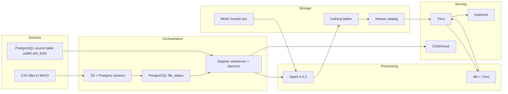
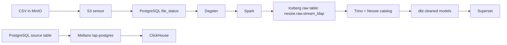

# DATA PLATFORM CONTEXT

## 1. Platform overview

This repository implements a local, Docker-based data platform centered on a batch ingestion and transformation workflow for LDAP-style log data. The platform stores raw log files in MinIO, loads them into a Spark/Iceberg/Nessie lakehouse, exposes the raw tables through Trino, and materializes cleaned models with dbt. Dagster orchestrates the ingestion and transformation steps and coordinates the Spark jobs and dbt builds.

The current processing model is batch-oriented and event-driven by file status rather than streaming messaging. Data is ingested from CSV files in MinIO into a raw Iceberg table; a dbt project reads that table and produces transformed tables in a cleaned schema. A separate Meltano-based PostgreSQL-to-ClickHouse job is configured and scheduled, but it is not part of the main CSV-to-lakehouse flow.

Major technologies present in the repository include:

- Python and Shell scripts
- Docker Compose for local service deployment
- Dagster for orchestration
- Apache Spark 4.0.2 for batch processing
- MinIO for S3-compatible object storage
- Project Nessie as the Iceberg catalog
- Apache Iceberg tables managed through Spark and Trino
- Trino as the query layer over the Iceberg catalog
- PostgreSQL for Dagster metadata and file tracking
- dbt with Trino adapter for transformation
- ClickHouse as a sink for a configured Meltano PostgreSQL replication job
- Apache Superset for dashboard serving

High-level architecture:

Data sources
    ↓
CSV files in MinIO / PostgreSQL source tables
    ↓
Dagster sensors and jobs
    ↓
Spark ingestion to Iceberg raw tables
    ↓
dbt transformation over Trino/Nessie Iceberg tables
    ↓
Superset and Trino query layer
    ↓
Optional ClickHouse sink for Meltano PostgreSQL replication

---

## 2. Technology stack

| Layer | Technology | How it is used |
| --- | --- | --- |
| Ingestion | CSV files in MinIO | Raw files are placed in the `soc` bucket under `data/` and are discovered by a Dagster sensor. |
| Ingestion | PostgreSQL | `dagster-db` stores Dagster metadata and operational file tracking through `file_status`; Meltano tap-postgres is configured against PostgreSQL as a source. |
| Processing | Apache Spark 4.0.2 | Runs batch jobs to read CSV from S3-compatible storage, validate schema, load Iceberg tables, and archive files. |
| Storage | MinIO | Acts as the object-store backend for the lakehouse warehouse and raw CSV landing zone. |
| Table format | Apache Iceberg | Used for the raw `nessie.raw.stream_ldap` table and queried through Trino with the Nessie catalog. |
| Orchestration | Dagster | Runs asset jobs, sensors, schedules, and resource definitions for Spark and dbt orchestration. |
| Transformation | dbt | Reads the raw Iceberg table and creates transformed tables in the `cleaned` schema. |
| Catalog / Metadata | Nessie | Serves as the Iceberg catalog backend and is integrated with Spark and Trino. |
| Catalog / Metadata | PostgreSQL | Dagster storage database and file registry database; Meltano state database also exists. |
| Streaming | Kafka | Not present in the repository. |
| Streaming | CDC | Not implemented in the repository. |
| Serving | Trino | Query engine for Iceberg tables in the Nessie catalog. |
| Serving | Superset | Query UI configured to connect to Trino. |
| Serving | ClickHouse | Target for the configured Meltano PostgreSQL replication pipeline. |
| Observability | Dagster logs | Dagster asset logs and compute logs are recorded locally under `/opt/dagster/logs` and persisted in PostgreSQL. |
| Observability | Spark logging | Spark job logs are emitted via a Python logger and included in Dagster run output. |
| Observability | OpenTelemetry | Not present in the repository. |
| Infrastructure | Docker Compose | Defines Spark, Spark worker, Dagster webserver, Dagster daemon, MinIO, Nessie, Trino, Superset, and ClickHouse services. |
| Infrastructure | AWS | No AWS Terraform, IAM, or cloud deployment manifests are present in the repository. |
| Infrastructure | Terraform | Not present in the repository. |
| CI/CD | GitHub Actions / CI pipeline | Not present in the repository. |

---

## 3. Architecture

The repository implements the following actual flow:

Data Sources
    ↓
MinIO raw CSV landing zone (`soc/data/`)
    ↓
Dagster sensor `s3_csv_check_sensor`
    ↓
PostgreSQL `file_status` table (`new` → `inprogress` → `success`/`failed`)
    ↓
Dagster job `bronze_logs_ingestion_job`
    ↓
Spark job `logs_ingest_parquet_write.py`
    ↓
Iceberg table `nessie.raw.stream_ldap` stored in MinIO
    ↓
Trino query layer through Nessie catalog
    ↓
dbt model `cleaned.stream_ldap` and `cleaned.ldap_event_enriched`
    ↓
Superset reads from the Trino/Iceberg layer

The platform has two distinct operational paths:

1. The primary data platform path: CSV landing in MinIO → Spark ingestion into Iceberg raw table → dbt transformation in a cleaned schema → Trino/Superset consumption.
2. A configured Meltano path: PostgreSQL source table `public-job_ticks` → Singer tap `tap-postgres` → target ClickHouse → ClickHouse database `mel`.

The first path is the repository’s main analytical workload. The second path is configured but separated from the raw CSV lakehouse flow.

---

## 4. Repository structure

```text
modern-data-lineage/
├── .env
├── .env.example
├── .dockerignore
├── README.md
├── docker-compose.yml
├── minio-file-dump.py
├── data/
│   └── logs.csv
├── dagster/
│   ├── Dockerfile
│   ├── dagster.yaml
│   ├── requirements.txt
│   ├── repository.py
│   ├── workspace.yaml
│   ├── assets/
│   │   ├── __init__.py
│   │   ├── adhoc_assets.py
│   │   ├── bronze_logs_assets.py
│   │   ├── dbt_assets.py
│   │   └── utils/
│   │       ├── dagster_utils.py
│   │       └── run_spark_script.py
│   ├── jobs/
│   │   └── __init__.py
│   ├── ops/
│   │   ├── __init__.py
│   │   ├── file_registry_ops.py
│   │   ├── mel_ops.py
│   │   └── storage_ops.py
│   ├── resources/
│   │   ├── __init__.py
│   │   ├── dbt_resource.py
│   │   ├── minio_resource.py
│   │   └── postgres_resource.py
│   ├── schedules/
│   │   └── mel_pg_ch_schedule.py
│   └── sensors/
│       ├── __init__.py
│       ├── postgres_pending_files_ingestion_sensor.py
│       ├── s3_csv_check_sensor.py
│       └── utils/
│           ├── postgres_utils.py
│           └── s3_utils.py
├── dbt/
│   └── modern_data_lineage/
│       ├── dbt_project.yml
│       ├── README.md
│       ├── dbt/
│       │   └── profiles.yml
│       ├── macros/
│       │   └── generate_schema_name.sql
│       ├── models/
│       │   ├── cleaned/
│       │   │   ├── ldap_event_enriched.sql
│       │   │   ├── schema.yml
│       │   │   └── stream_ldap.sql
│       │   └── structured/
│       │       ├── incidents.sql
│       │       └── schema.yml
│       └── logs/
├── docker/
│   ├── init-multiple-dbs.sql
│   ├── postgres/
│   │   ├── Dockerfile
│   │   └── custom-postgres.conf
│   └── superset-init.sh
├── meltano/
│   ├── .gitignore
│   ├── README.md
│   ├── meltano.yml
│   ├── requirements.txt
│   ├── analyze/
│   ├── extract/
│   ├── load/
│   ├── notebook/
│   ├── orchestrate/
│   ├── output/
│   ├── plugins/
│   │   ├── extractors/
│   │   └── loaders/
│   └── transform/
├── spark-apps/
│   ├── logs_ingest_parquet_write.py
│   ├── raw_schema_viewer.py
│   ├── scripts/
│   │   └── run_spark.sh
│   └── utils/
│       ├── columns_check.py
│       └── logging_config_spark.py
├── trino/
│   └── catalog/
│       └── nessie.properties
└── ...
```

Important directories:

- `dagster/`: Dagster code, resources, jobs, schedules, sensors, and Docker runtime definitions.
- `spark-apps/`: Spark jobs and shell launcher used by Dagster.
- `dbt/modern_data_lineage/`: dbt project used to model the processed lakehouse data.
- `meltano/`: Meltano project for PostgreSQL extraction to ClickHouse.
- `docker/`: Postgres initialization and Superset service bootstrap.
- `trino/`: Trino catalog configuration for the Iceberg/Nessie catalog.
- `data/`: Local sample data directory; the repo contains `logs.csv`.
- `docker-compose.yml`: Local deployment definition for the platform services.

---

## 5. Data sources

### 1. MinIO object storage / CSV landing zone

- Source type: object storage bucket containing raw CSV files
- Source technology: MinIO
- Data format: CSV
- Connection mechanism: S3-compatible endpoint `http://minio:9000` and `s3a://soc/`
- Ingestion mechanism: discovered by Dagster sensor `s3_csv_check_sensor`
- Relevant configuration:
  - `MINIO_ENDPOINT=http://minio:9000`
  - `MINIO_ENDPOINT_RESOURCE=minio:9000`
  - `MINIO_BUCKET_URL=s3a://soc/`
  - `MINIO_ACCESS_KEY=minioadmin`
  - `MINIO_SECRET_KEY=minioadmin`
- Destination: raw Iceberg table `nessie.raw.stream_ldap`

### 2. PostgreSQL database used as a source and tracker

- Source type: relational database
- Source technology: PostgreSQL
- Data format: rows in tables; source table is configured for Meltano `tap-postgres`
- Connection mechanism: JDBC/SQLAlchemy/Postgres client configuration using env vars such as `TAP_POSTGRES_HOST`, `TAP_POSTGRES_PORT`, `TAP_POSTGRES_USER`, `TAP_POSTGRES_PASSWORD`, `TAP_POSTGRES_DBNAME`
- Ingestion mechanism: Meltano `tap-postgres` extracts from `public-job_ticks` and loads to ClickHouse through `target-clickhouse`
- Relevant configuration: defined in `meltano/meltano.yml`
- Destination: ClickHouse database `mel`

### 3. Dagster metadata and file registry database

- Source type: internal operational metadata store
- Source technology: PostgreSQL
- Data format: relational table rows for Dagster and file tracking
- Connection mechanism: `DAGSTER_PG_HOST`, `DAGSTER_PG_PORT`, `DAGSTER_PG_USER`, `DAGSTER_PG_PASSWORD`, `DAGSTER_CUSTOM_PG_DB`
- Ingestion mechanism: direct SQL via Python `psycopg2` connections in Dagster resources and sensors
- Relevant configuration: `dagster/dagster.yaml`, `.env`, `dagster/resources/postgres_resource.py`
- Destination: `file_status` table and Dagster storage schema

### 4. Local sample log dataset

- Source type: sample file
- Source technology: local filesystem
- Data format: CSV
- Connection mechanism: `minio-file-dump.py` uploads `data/logs.csv` into MinIO bucket `soc`
- Ingestion mechanism: manual loading to object storage before or during local demo runs
- Destination: `soc/data/logs.csv` then Spark ingestion into raw Iceberg

### 5. Kafka or CDC sources

- Kafka: not present in this repository
- CDC: not implemented in this repository

---

## 6. Ingestion

### Ingestion path 1: CSV into raw Iceberg table

This is the repository’s main implemented ingestion flow.

- Trigger: Dagster sensor `s3_csv_check_sensor` runs on a 60-second interval and detects `.csv` objects in the MinIO bucket under the `data/` prefix.
- Source: MinIO bucket `soc`, prefix `data/`
- Reader/connector: Spark `spark.read.csv(...)` over `s3a://soc/...` paths using the Hadoop S3A connector and Iceberg runtime packages
- Processing: the Spark job validates columns, casts `_serial` to integer, casts `_raw` to string, ensures `_serial` is non-null, creates the `nessie.raw` namespace if needed, creates the `nessie.raw.stream_ldap` table on first run, and upserts subsequent data using `MERGE INTO` on `_serial`
- Schema handling:
  - initial CSV is read with `header=true`
  - columns are validated by `spark-apps/utils/columns_check.py`
  - selected columns are `_serial` and `_raw`
  - on first run, a table is created using `.writeTo("nessie.raw.stream_ldap").create()`
- Destination: Iceberg table `nessie.raw.stream_ldap` stored under the Nessie catalog/warehouse in MinIO
- File/table format:
  - input: CSV
  - landing file archive: parquet under `s3a://soc/data/archived/<timestamp>`
  - target: Iceberg table
- Naming conventions:
  - bucket: `soc`
  - folder: `data/`
  - archive folder: `data/archived/`
  - namespace: `raw`
  - table: `stream_ldap`
- Metadata generated:
  - file entries in PostgreSQL `file_status`
  - Iceberg table metadata in Nessie and warehouse storage
- Orchestration relationship:
  - `s3_csv_check_sensor` triggers `file_registration_job`
  - `postgres_pending_files_ingestion_sensor` triggers `bronze_logs_ingestion_job`
  - `logs_ingest_parquet_write` is the Spark asset launched by Dagster

### Ingestion path 2: PostgreSQL to ClickHouse via Meltano

- Trigger: Dagster scheduled job `mel_pg_ch_job` runs a daily schedule at 02:00 via `dagster/schedules/mel_pg_ch_schedule.py`
- Source: PostgreSQL table `public-job_ticks` from the configured database
- Reader/connector: `tap-postgres` from the transferwise Meltano plugin
- Processing: Singer extraction to `target-clickhouse`
- Schema handling: target loader is configured with `database`, `default_target_schema`, and `engine_type` set to `ReplacingMergeTree`
- Destination: ClickHouse database `mel` and schema `mel`
- File/table format: row-based replication into ClickHouse tables; no Kafka or CDC involved
- Naming conventions: `tap-postgres` + `target-clickhouse` job called `pg-ch`
- Metadata generated: Meltano state database at `dagster-db:5432/meltano` and ClickHouse table metadata; repository does not include generated migration files for target schema creation
- Orchestration relationship: triggered by Dagster `mel_pg_ch_job`, not by file sensors

### File registry and job state flow

The file tracking table is used in the CSV ingestion flow and is defined by runtime SQL in the Dagster code, not by a schema migration file in the repo.

- Insert into `file_status` with `status = 'new'` when a MinIO CSV is detected
- Update to `status = 'inprogress'` and assign `job_id` when sensor launches the Spark run
- Update to `status = 'success'` or `failed` after the Spark process completes
- Keys used in the code include `file_name`, `status`, `job_id`, `started_at`, `finished_at`, `updated_at`

---

## 7. Storage

### Object storage

- Technology: MinIO
- Endpoint: `http://minio:9000`
- Console endpoint: `http://localhost:9001`
- Bucket: `soc`
- Warehouse and landing path: `s3://soc/` and `s3a://soc/`
- Root data directory: `/data` in the MinIO container

### Raw landing files

- Path prefix: `data/`
- File type: CSV
- Example: `data/logs.csv`
- Archive path: `data/archived/<timestamp>` as Parquet

### Iceberg lakehouse storage

- Catalog type: Nessie-backed Iceberg catalog
- Catalog URI: `http://nessie:19120/api/v1`
- Catalog branch: `main`
- Default warehouse directory: `s3://soc/`
- Namespace used by Spark: `nessie.raw`
- Table used by main ingestion flow: `nessie.raw.stream_ldap`
- Trino catalog config file: `trino/catalog/nessie.properties`

### Filesystem-level S3 configuration

Configured in Spark and Trino as S3A / S3-compatible access:

- `spark.hadoop.fs.s3a.endpoint=$MINIO_ENDPOINT`
- `spark.hadoop.fs.s3a.path.style.access=true`
- `spark.hadoop.fs.s3a.impl=org.apache.hadoop.fs.s3a.S3AFileSystem`
- `spark.hadoop.fs.s3a.access.key=$MINIO_ACCESS_KEY`
- `spark.hadoop.fs.s3a.secret.key=$MINIO_SECRET_KEY`
- Trino `fs.native-s3.enabled=true`
- Trino `s3.endpoint=http://minio:9000`
- Trino `s3.path-style-access=true`

### Table format and catalog behavior

- The Spark job uses `spark.sql.extensions=org.apache.iceberg.spark.extensions.IcebergSparkSessionExtensions`
- The catalog is configured as `spark.sql.catalog.nessie=org.apache.iceberg.spark.SparkCatalog`
- Catalog implementation is `org.apache.iceberg.nessie.NessieCatalog`
- The data catalog is not configured as Hive metastore and is not configured for a separate AWS Glue catalog in this repo

### Metadata and snapshot/versioning

- Iceberg metadata is managed by Nessie catalog state and the Iceberg table metadata files written in the warehouse.
- Spark writes Iceberg tables into the configured warehouse path and uses `MERGE INTO` for incremental upsert behavior.
- Repository does not contain explicit snapshot retention or branching policy configuration beyond the `main` branch in Nessie.
- No Iceberg table compaction or rewrite configuration is present in the repo.

---

## 8. Data layers

### Raw layer

- Raw layer name used in the code: `raw`
- Table: `nessie.raw.stream_ldap`
- Contents:
  - `_serial`: integer sequence identifier
  - `_raw`: JSON payload string from the CSV
- Produced by: `spark-apps/logs_ingest_parquet_write.py`
- Storage format: Iceberg table in MinIO-backed warehouse
- Access pattern: direct Spark catalog write and Trino reads via the Nessie catalog

### Cleaned layer

- Schema: `cleaned`
- Models:
  - `cleaned.stream_ldap`
  - `cleaned.ldap_event_enriched`
- Produced by: dbt models with `materialized='table'`
- Logic:
  - `stream_ldap` parses JSON from `_raw` into structured columns such as `src_ip`, `dest_ip`, `src_port`, `dest_port`, `event_type`, and derived timestamp fields
  - `ldap_event_enriched` adds event categories, protocol classification, encryption and authentication flags, severity, and date/hour fields
- Source: `{{ source('raw', 'stream_ldap') }}` from `nessie.raw.stream_ldap`

### Structured layer

- Directory: `dbt/modern_data_lineage/models/structured/`
- File: `incidents.sql` is present but empty
- Schema file: `schema.yml` is empty
- This layer is not implemented beyond the empty model files

### Gold layer

- No separate `gold` schema or gold transformation layer is implemented in the repository.
- The project uses `cleaned` as the transformed layer, not `gold`.

---

## 9. Spark

### Spark version and deployment model

- Docker image: `apache/spark:4.0.2-scala2.13-java17-python3-r-ubuntu`
- Deployment model: local multi-container Docker Compose deployment with one Spark master and one Spark worker
- Master URL: `spark://spark:7077`
- Job launcher: `spark-apps/scripts/run_spark.sh`

### Spark applications and jobs

#### `spark-apps/logs_ingest_parquet_write.py`

- Purpose: read new CSV files from MinIO, validate them, write to the raw Iceberg table, and archive the source files to a Parquet archive path
- Input sources:
  - PostgreSQL `file_status` table via JDBC for job-specific file names
  - MinIO `s3a://soc/<file>` objects
- Output destinations:
  - `nessie.raw.stream_ldap` Iceberg table
  - `s3a://soc/data/archived/<timestamp>` parquet archive
- Batch behavior:
  - reads all selected files for a given `job_id`
  - merges into the raw table using `_serial` as the key
- Partitioning: no explicit Spark partitioning config is present in the repo
- Checkpointing: not present
- Spark config:
  - `spark.sql.csv.maxCharsPerColumn` set to `1000000`
  - `spark.app.postgres.url`, `spark.app.postgres.user`, `spark.app.postgres.password` provided via `--conf`

#### `spark-apps/raw_schema_viewer.py`

- Purpose: prints the schema of `nessie.raw.stream_ldap`
- Input source: Iceberg table in Nessie catalog
- Output: Spark schema printout to logs

### Spark configuration and Iceberg integration

The launcher script uses the following settings:

- `--packages org.apache.iceberg:iceberg-spark-runtime-4.0_2.13:1.10.1,org.apache.hadoop:hadoop-aws:3.3.4,com.amazonaws:aws-java-sdk-bundle:1.12.262,org.postgresql:postgresql:42.7.3`
- `--conf spark.sql.extensions=org.apache.iceberg.spark.extensions.IcebergSparkSessionExtensions`
- `--conf spark.sql.catalog.nessie=org.apache.iceberg.spark.SparkCatalog`
- `--conf spark.sql.catalog.nessie.catalog-impl=org.apache.iceberg.nessie.NessieCatalog`
- `--conf spark.sql.catalog.nessie.uri=$NESSIE_ENDPOINT`
- `--conf spark.sql.catalog.nessie.ref=$NESSIE_BRANCH`
- `--conf spark.sql.catalog.nessie.warehouse=$MINIO_BUCKET_URL`
- S3A connection config for MinIO

### Relevant dependencies

- `dagster/requirements.txt` includes `pyspark`.
- Spark jobs depend on Java/Scala runtime within the Spark container and the Iceberg runtime packages.

---

## 10. Dagster

### Dagster implementation

The repo uses Dagster as the central orchestrator for file processing and dbt execution.

- Dagster version: included in `dagster/requirements.txt`
- Storage backend: PostgreSQL using `dagster/dagster.yaml`
- Webserver: `dagit -h 0.0.0.0 -p 3000 -w /opt/dagster/app/workspace.yaml`
- Daemon: `dagster-daemon run`
- Metadata database: `dagster-db` PostgreSQL container
- Runtime storage DB: configured with `DAGSTER_INTERNAL_PG_DB=dagster`
- Custom DB used by app logic: `DAGSTER_CUSTOM_PG_DB=custom`

### Definitions and repository structure

`dagster/repository.py` creates `Definitions` with:

- assets: `all_assets`
- jobs: `all_jobs`
- sensors: `all_sensors`
- resources: `all_resources`
- schedules: `all_schedules`

### Assets

`dagster/assets/__init__.py` loads three groups of assets:

- `adhoc_assets` from `adhoc_assets.py`
- `bronze_logs_ingestion_assets` from `bronze_logs_assets.py`
- `dbt_assets` from `dbt_assets.py`

#### `logs_ingest_parquet_write`

- Asset key: `raw`, `stream_ldap`
- Required resource: `postgres_app`
- Runs the Spark script via `run_spark("logs_ingest_parquet_write.py", job_id)`
- Logs the output from the subprocess
- Uses `job_id` from `context.op_config["job_id"]`
- Updates the `file_status` row to `success` or `failed` based on Spark exit code
- Raises an exception if the Spark job fails

#### `raw_schema_viewer`

- Asset in `group_name="ops"`
- Runs `raw_schema_viewer.py` via the Spark launcher and logs schema output

#### `check_postgres_connection`

- Asset in `group_name="ops"`
- Validates connectivity to the custom Postgres resource

### Jobs

- `bronze_logs_ingestion_job`: defined with `AssetSelection.groups("bronze_logs_ingestion_assets")`
- `file_registration_job`: executes `register_new_files_into_postgres`
- `mel_pg_ch_job`: executes `run_meltano_pg_ch`

### Schedules

- `dagster/schedules/mel_pg_ch_schedule.py` defines `pg_ch_repliaction`
- Schedule: `0 2 * * *` (02:00 daily)
- Target: `mel_pg_ch_job`

### Sensors

#### `s3_csv_check_sensor`

- Runs every 60 seconds
- `default_status=STOPPED`
- Calls `list_csv_files_from_s3(minio)`
- If CSV files exist, yields a `RunRequest` for `file_registration_job`

#### `postgres_pending_files_ingestion_sensor`

- Runs every 50 seconds
- `default_status=STOPPED`
- Checks `file_status` for rows with `status='new'`
- Creates a new `job_id` and marks files as `inprogress`
- Yields a `RunRequest` for the asset job with `op_config` for `job_id`

### Resources

- `MinioResource` (`dagster/resources/minio_resource.py`)
- `PostgresResource` (`dagster/resources/postgres_resource.py`)
- `dbt_resource` (`dagster/resources/dbt_resource.py`)

### DBT integration

- `dagster/assets/dbt_assets.py` defines a dbt asset named `cleaned_assets`
- It reads `manifest.json` from `dbt/modern_data_lineage/target/manifest.json`
- It selects `tag:cleaned`
- It runs `dbt build` via `dbt.cli(["build"], context=context).stream()`

### Relationship with Spark

Spark jobs are launched by Dagster using a container-exec command from the Dagster container to the `spark` service. The helper `dagster/assets/utils/run_spark_script.py` passes the environment variables to `docker exec -e ... spark bash /opt/spark-apps/scripts/run_spark.sh <script> [job_id]`.

### Relationship with ingestion

Dagster orchestrates the full CSV ingestion lifecycle from object discovery through file status tracking and Spark job launch.

### Relationship with dbt

Dagster executes the dbt build for the `cleaned` tag after the raw table exists.

---

## 11. dbt

### Project structure

The project is located at `dbt/modern_data_lineage/` and is configured with:

- `dbt_project.yml`
- `dbt/profiles.yml`
- models under `models/cleaned/` and `models/structured/`
- macros under `macros/`
- logs under `logs/`

### Profile and target

Profile name: `modern_data_lineage`

Target:

- `target: dev`
- adapter: `trino`
- host: `trino`
- port: `8080`
- database: `nessie`
- schema: `raw`
- method: `none`
- http scheme: `http`

### Models implemented

#### `models/cleaned/stream_ldap.sql`

- materialized as `table`
- schema: `cleaned`
- tags: `cleaned`
- source: `{{ source('raw', 'stream_ldap') }}`
- parsing logic:
  - `_serial` cast to bigint
  - `_time` parsed from JSON `timestamp` using `from_iso8601_timestamp`
  - `src_ip`, `dest_ip`, `src_port`, `dest_port`, `event_type` extracted from `_raw`
  - rows with null `_raw` filtered out

#### `models/cleaned/ldap_event_enriched.sql`

- materialized as `table`
- schema: `cleaned`
- tags: `cleaned`
- source: `{{ ref('stream_ldap') }}`
- produced columns include:
  - `event_id`
  - `event_time`
  - `src_ip`, `dest_ip`, `src_port`, `dest_port`
  - `event_type`
  - `event_category`
  - `protocol`
  - `is_encrypted`
  - `is_authentication`
  - `is_search_activity`
  - `severity`
  - `event_hour`
  - `event_date`

### Sources

`models/cleaned/schema.yml` contains:

- source name: `raw`
- schema: `raw`
- database: `nessie`
- table: `stream_ldap`

### Macros

`macros/generate_schema_name.sql` exists and returns the supplied schema name unchanged.

### Structured models

`models/structured/incidents.sql` is empty.
`models/structured/schema.yml` is empty.

### Materializations

- The configured dbt models are materialized as `table` and use tags `cleaned`.
- There are no incremental dbt models in the repository.
- There are no seed files or snapshot files configured in the actual project directories.

### Relationship with lakehouse

The dbt project reads from the `nessie` catalog and the raw Iceberg table through Trino. It writes its materialized tables into the `cleaned` schema, which is also served via Trino.

### Relationship with Dagster

Dagster executes the dbt build using the `cleaned` tag and the `DbtCliResource` configured in `dagster/resources/dbt_resource.py`.

---

## 12. Kafka / Streaming

### Current status

Kafka is not implemented in this repository.

### Evidence

- No Kafka service is defined in the Docker Compose file.
- No Kafka producer or consumer code is present in the Python code.
- No topic configuration, partitions, or consumer group definitions are present.
- No `kafka-python`, `confluent-kafka`, or similar dependency is present in the repository.

### Configured but unused / mentioned but not implemented

- Not present.
- `UNKNOWN — cannot be determined from repository` for any undocumented Kafka integration.

### CDC state

CDC is not implemented in this repository.

---

## 13. CDC

CDC is not currently implemented.

There is no Debezium connector, no change-data-capture pipeline, no Kafka pipeline for database changes, and no event ingestion pattern from a database transaction log into the lakehouse.

The repo demonstrates a CSV-to-Iceberg batch flow and a separate Meltano PostgreSQL-to-ClickHouse replication job, but not a database log-based CDC pattern.

---

## 14. Data transformation

Transformation is split across Spark and dbt:

### Spark transformation

The Spark job performs the raw ingestion transform by:

- reading CSV from MinIO
- validating columns
- casting values to typed columns
- selecting `_serial` and `_raw`
- writing or merging into the Iceberg raw table through `nessie.raw.stream_ldap`

The transformation is intentionally minimal at this stage: the raw CSV is loaded to the raw table without broader parsing beyond the needed fields.

### dbt transformation

The dbt project transforms the raw data into a cleaned layer:

- `cleaned.stream_ldap` extracts fields from the JSON payload stored in `_raw`
- `cleaned.ldap_event_enriched` enriches those fields into event categories, protocol flags, and severity descriptors

### Output tables

- `nessie.raw.stream_ldap` raw table
- `cleaned.stream_ldap` table
- `cleaned.ldap_event_enriched` table

There is no implemented separate gold layer or curated business model layer in the repo.

---

## 15. Data modeling

### Current modeled entities

The main modeled entity is an LDAP event stream.

### Raw model

`nessie.raw.stream_ldap`

Columns observed in the code:

- `_serial`
- `_raw`

The Spark job selects only these two columns from the CSV and writes them to the Iceberg table.

### Cleaned model

`cleaned.stream_ldap`

Fields created in the dbt model include:

- `_serial`
- `_time`
- `src_ip`
- `dest_ip`
- `src_port`
- `dest_port`
- `event_type`

### Enriched model

`cleaned.ldap_event_enriched`

Fields created include:

- `event_id`
- `event_time`
- `src_ip`
- `dest_ip`
- `src_port`
- `dest_port`
- `event_type`
- `event_category`
- `protocol`
- `is_encrypted`
- `is_authentication`
- `is_search_activity`
- `severity`
- `event_hour`
- `event_date`

### Keys and grain

- `_serial` is used as the merge key in the Spark ingestion logic.
- `event_id` is created in dbt from `_serial`.
- There is no explicit star schema model, dimension table, or fact table pattern in the repository beyond the event-centric transformed tables.
- The repo does not implement SCD, surrogate keys, business keys beyond the event sequence identifier, or formal data marts.

---

## 16. Metadata and catalog

### Catalog and metadata infrastructure

- Catalog: Nessie
- Table format: Iceberg
- Query engine: Trino reading the `nessie` catalog
- Metadata database: PostgreSQL for Dagster and file tracking
- Table metadata: stored in the Iceberg warehouse under the configured MinIO-backed storage location

### Metadata stores in use

#### Dagster metadata

- Dagster uses PostgreSQL for run storage and event storage as defined in `dagster/dagster.yaml`
- File tracking uses a `file_status` table in the custom Postgres database

#### Iceberg metadata

- Managed by Nessie as the catalog and by Iceberg metadata files in the warehouse directory.
- Spark writes and merges against `nessie.raw.stream_ldap`

#### Trino metadata

- Trino catalog is configured through `trino/catalog/nessie.properties`
- The `iceberg` connector reads the catalog via Nessie and the MinIO-backed S3 warehouse directory

#### dbt metadata

- dbt is configured with `manifest.json` and reads the source table definition from `schema.yml`
- The generated manifest is built during the Dagster Docker build via `dbt parse`

### Lineage

- Lineage is not implemented as a formal metadata store in the repo beyond the dbt manifest and table relationships visible in SQL and YAML files.
- The repo does not include a dedicated data lineage catalog or a lineage service.

---

## 17. Observability

### Logging

Implemented logging exists in the following places:

- Dagster asset logs via `context.log.info(...)` and `context.log.error(...)`
- Spark job logs emitted by `get_spark_logger(job_id)` from `spark-apps/utils/logging_config_spark.py`
- Shell launcher prints environment validation and job summary in `spark-apps/scripts/run_spark.sh`

### Metrics

- No explicit metrics collection system is implemented in the repository.
- No Prometheus, StatsD, or Grafana definitions are present.

### Traces

- OpenTelemetry is not implemented.
- No `opentelemetry` or telemetry instrumentation is present.

### Observability services

- Dagster UI and compute logs are part of the local stack.
- Spark UI is exposed through the master container on port `8080` and the worker on `8081`.
- Kafka monitoring is not present.
- ClickHouse logging is present as a container runtime log volume, but no application-level metrics stack is configured.

---

## 18. Infrastructure

### Deployment model

The platform is deployed locally via Docker Compose.

### Services defined in `docker-compose.yml`

- `spark`: Spark master
- `spark-worker`: Spark worker
- `dagster-db`: PostgreSQL instance for Dagster metadata and file-tracking database
- `webserver`: Dagster webserver
- `daemon`: Dagster daemon
- `minio`: MinIO object storage
- `nessie`: Nessie catalog service
- `trino`: Trino query service against the Iceberg catalog
- `superset`: Superset dashboard app
- `clickhouse`: ClickHouse database

### Network and storage

- Docker volumes are defined for:
  - `dagster_db_data`
  - `superset_home`
  - `minio_data`
  - `nessie_data`
  - `clickhouse_data`
  - `clickhouse_log`
- The system is local-only and not configured for a cloud provider deployment.

### AWS / cloud configuration

- No Terraform configuration is present.
- No AWS IAM, S3 bucket policy, Lambda, EC2, or ECS definitions are present.
- The repo uses MinIO as the storage backend rather than AWS S3.

### Database services

- PostgreSQL is used for Dagster metadata and custom file tracking.
- ClickHouse is used for the Meltano target sink.
- No MySQL, MongoDB, Snowflake, or other platform databases are present.

---

## 19. Development environment

### Local startup

The project runs through Docker Compose using `docker-compose.yml`.

### Required services

The stack includes the following runtime dependencies:

- `spark`
- `spark-worker`
- `dagster-db`
- `webserver`
- `daemon`
- `minio`
- `nessie`
- `trino`
- `superset`
- `clickhouse`

### Ports exposed

- Spark master: `7077` and `8081`
- Spark worker: `8082`
- Dagster webserver: `3000`
- MinIO API: `8999`
- MinIO console: `9001`
- Nessie: `19120`
- Superset: `8088`
- ClickHouse: `8123`, `10000`
- PostgreSQL: `5432`

### Environment configuration

- `.env` contains the runtime secrets names and service configuration values used by the stack.
- `.env.example` shows the expected variable names without actual values.
- Secret names include `MINIO_ACCESS_KEY`, `MINIO_SECRET_KEY`, `DAGSTER_PG_PASSWORD`, `SUPERSET_ADMIN_PASSWORD`, `TARGET_CLICKHOUSE_PASSWORD`, and others.

### Local data initialization

- `minio-file-dump.py` creates the `soc` bucket and uploads `data/logs.csv` to MinIO.
- `docker/init-multiple-dbs.sql` creates the `meltano` database during Postgres initialization.

### Development tools

- Dagster container includes `meltano` and `dbt` installation in the image build process.
- dbt is parsed during image build with `dbt parse`.
- Meltano is installed during image build with `meltano install`.

---

## 20. Configuration

| Configuration component | Purpose |
| --- | --- |
| `SPARK_MASTER_URL` / `SPARK_URL` | Spark master endpoint for jobs and launcher configuration. |
| `DAGSTER_HOME` | Dagster runtime home. |
| `DAGSTER_PG_HOST` / `DAGSTER_PG_PORT` / `DAGSTER_PG_USER` / `DAGSTER_PG_PASSWORD` / `DAGSTER_INTERNAL_PG_DB` / `DAGSTER_CUSTOM_PG_DB` | PostgreSQL connection details for Dagster metadata and custom file-tracking database. |
| `POSTGRES_USER` / `POSTGRES_PASSWORD` / `POSTGRES_DB` | Base Postgres service configuration for the Dagster database container. |
| `MINIO_ENDPOINT` / `MINIO_ENDPOINT_RESOURCE` / `MINIO_BUCKET_URL` | MinIO access configuration for the Spark and Dagster app layers. |
| `MINIO_ACCESS_KEY` / `MINIO_SECRET_KEY` | S3-compatible object store credentials. |
| `NESSIE_ENDPOINT` / `NESSIE_BRANCH` | Nessie catalog connection and branch targeting. |
| `NESSIE_VERSION_STORE_TYPE` / `NESSIE_VERSION_STORE_PERSIST_ROCKS_DB_PATH` | Nessie storage backend configuration. |
| `SUPERSET_SECRET_KEY` / `SUPERSET_ADMIN_*` | Superset admin configuration. |
| `MELTANO_DATABASE_URI` | Meltano state backend persistence database. |
| `TAP_POSTGRES_*` | PostgreSQL source configuration for Meltano tap-postgres. |
| `TARGET_CLICKHOUSE_*` | ClickHouse target configuration for Meltano target-clickhouse. |
| `CLICKHOUSE_DB` / `CLICKHOUSE_USER` / `CLICKHOUSE_PASSWORD` | ClickHouse service runtime configuration. |
| `dbt_project.yml` / `profiles.yml` | dbt project metadata and Trino connection settings. |
| `nessie.properties` | Trino access configuration to the Nessie/Iceberg warehouse. |

No passwords, tokens, or secrets are included in this file as literal values. Configuration names are listed only by purpose.

---

## 21. End-to-end data flows

### Flow 1 — Source CSV to raw Iceberg table

1. A CSV file is uploaded into MinIO under `soc/data/`.
2. `s3_csv_check_sensor` lists `.csv` objects in MinIO.
3. `file_registration_job` inserts file names into `file_status` with `status='new'`.
4. `postgres_pending_files_ingestion_sensor` finds `status='new'` rows and marks them as `inprogress` with a `job_id`.
5. Dagster launches the Spark ingest asset for that `job_id`.
6. The Spark job queries PostgreSQL for the file list and reads the CSV from `s3a://soc/<file>`.
7. The Spark job validates the schema, selects `_serial` and `_raw`, and writes or merges into `nessie.raw.stream_ldap`.
8. The source CSV is archived to `s3a://soc/data/archived/<timestamp>` in Parquet format.

### Flow 2 — Raw Iceberg table to dbt cleaned models

1. Trino queries the `nessie` catalog and reads `nessie.raw.stream_ldap`.
2. The dbt project defines the raw source as `source('raw','stream_ldap')`.
3. `cleaned.stream_ldap` reads from and transforms the raw JSON payload.
4. `cleaned.ldap_event_enriched` reads from `stream_ldap` and adds classification logic.
5. Dagster runs `dbt build` for the `cleaned` tag.

### Flow 3 — Lakehouse to serving layer

1. Trino serves the Iceberg datasets to external consumers.
2. Superset is configured to connect to Trino and can query the `nessie` catalog and `cleaned` schema.
3. No dedicated semantic layer or mart layer is implemented beyond the dbt models.

### Flow 4 — PostgreSQL to ClickHouse via Meltano

1. `tap-postgres` is configured against PostgreSQL and selects `public-job_ticks`.
2. Meltano runs the job `pg-ch`.
3. `target-clickhouse` writes the extracted rows to ClickHouse.
4. Dagster schedules this job daily through `mel_pg_ch_schedule.py`.

---

## 22. Architecture diagram



---

## 23. Current implementation status

| Component | Status | Evidence |
| --- | --- | --- |
| Spark | Implemented | Spark master and worker containers, Spark launcher script, and Spark jobs exist in the repo. |
| Dagster | Implemented | Repository, assets, jobs, resources, sensors, schedules, and webserver/daemon stack are present. |
| dbt | Implemented | dbt project, profile, models, sources, and tags are present. |
| MinIO | Implemented | Service and bucket configuration are present in Docker Compose and environment variables. |
| Nessie | Implemented | Service and Trino/Spark catalog configuration are present. |
| Iceberg | Implemented | Spark runtime packages and catalog config are present; raw table is created in the `nessie` catalog. |
| Trino | Implemented | Docker service and catalog config are present. |
| PostgreSQL | Implemented | Dagster DB and custom file tracking database are configured. |
| Superset | Implemented | Service deployment and bootstrap script are present. |
| ClickHouse | Implemented | Container and target-clickhouse config are present. |
| Meltano | Implemented | `meltano.yml` and plugin definitions are present. |
| Kafka | Not implemented | No Kafka service or code references exist. |
| CDC | Not implemented | No Debezium or log-based change capture flow exists. |
| Terraform | Not implemented | No infrastructure-as-code files are present. |
| AWS deployment | Not implemented | No cloud deployment manifests are present. |
| OpenTelemetry | Not implemented | No telemetry package or config is present. |
| CI/CD | Not implemented | No GitHub Actions or pipeline config is present. |
| Tests | Unknown | No test framework or tests are evident in the repository. |

---

## 24. Important architectural facts

- The primary analytical flow is CSV in MinIO → Spark → Iceberg raw table → dbt cleaned models → Trino/Superset.
- The raw lakehouse table is `nessie.raw.stream_ldap` and is stored in MinIO through the Nessie catalog and Iceberg format.
- Dagster is the operational orchestrator for file discovery, file registration, Spark job execution, and dbt builds.
- The platform makes use of a local dev container architecture rather than a cloud-deployed environment.
- There is no Kafka, no CDC flow, and no event bus in the implemented architecture.
- The repository includes a separate Meltano PostgreSQL-to-ClickHouse pipeline configured as a daily scheduled job.
- The raw data is not stored in a relational database in the main path; it is stored as Iceberg tables in the MinIO/Nessie lakehouse.
- The actual transformed naming convention in the repo is `raw` and `cleaned`, not a formal `bronze/silver/gold` nomenclature. The `structured` directory exists but is not implemented.

---

# LLM QUICK CONTEXT

## Platform
This repo is a local Docker-based data platform for batch ingestion and transformation of LDAP-style log data. The main flow loads CSV files from MinIO into a Spark/Iceberg lakehouse, then transforms them with dbt and queries them through Trino and Superset. Dagster orchestrates the ingestion and dbt steps; a secondary Meltano job moves PostgreSQL rows into ClickHouse.

## Architecture


## Stack
Python, Dagster, Apache Spark 4.0.2, MinIO, Nessie, Apache Iceberg, Trino, PostgreSQL, dbt, ClickHouse, Superset, Docker Compose.

## Data Flow
CSV files are landed in MinIO, discovered by Dagster sensors, tracked in PostgreSQL, processed by Spark into an Iceberg raw table, transformed by dbt, and exposed via Trino. A separate Meltano pipeline extracts PostgreSQL data into ClickHouse.

## Storage
Raw CSVs live in MinIO `soc/data/`; the main lakehouse table is `nessie.raw.stream_ldap` in the Nessie-backed Iceberg catalog; the warehouse is in MinIO via S3-compatible settings.

## Processing
Spark runs the ingest job, validates schema, merges by `_serial`, and archives files to `data/archived/` as Parquet. dbt parses JSON payloads in `_raw` and builds cleaned tables.

## Orchestration
Dagster schedules and triggers file detection, file registration, Spark ingestion, and dbt builds. The `pg-ch` Meltano job is also scheduled daily.

## Transformation
The transformation layer is implemented in dbt; `cleaned.stream_ldap` parses raw JSON and `cleaned.ldap_event_enriched` adds classification fields such as protocol, authentication indicator, and severity.

## Streaming
No Kafka or CDC flow is implemented in this repo.

## Data Model
The main modeled record is an LDAP event; raw data is stored as `_serial` and `_raw`, then structured into event fields like `src_ip`, `dest_ip`, `event_type`, and derived flags in the cleaned layer.

## Infrastructure
Local Docker Compose deployment with Spark, Dagster, MinIO, Nessie, Trino, Superset, and ClickHouse services. No Terraform or cloud deployment manifests are present.

## Current State
Implemented: Spark, Dagster, dbt, MinIO, Nessie, Iceberg, Trino, PostgreSQL, Superset, ClickHouse, Meltano. Not implemented: Kafka, CDC, Terraform, AWS deployment, OpenTelemetry, formal CI/CD pipeline.
