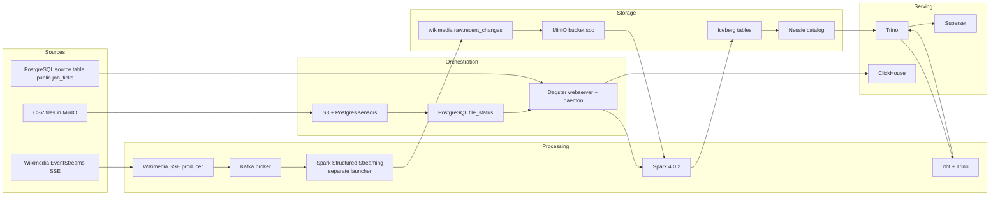
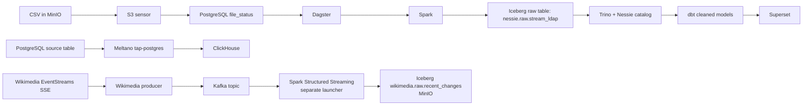

# DATA PLATFORM CONTEXT

## 1. Platform overview

This repository implements a local, Docker-based data platform with a batch LDAP-log lakehouse workflow and a separate Wikimedia recent-changes streaming path. In the batch workflow, Dagster coordinates CSV ingestion from MinIO through Spark into a Nessie-cataloged Iceberg table, then runs dbt transformations exposed through Trino. The streaming components include a Wikimedia EventStreams SSE producer, a Kafka broker, and a Spark Structured Streaming consumer that writes to a separate Iceberg table in MinIO.

The batch CSV-to-lakehouse path is orchestrated by Dagster. The Kafka producer is started by Docker Compose, while the Spark streaming consumer and its launcher are present in the repository but are not wired to a Compose service or Dagster job. A separate Meltano PostgreSQL-to-ClickHouse job is also configured and scheduled.

Major technologies present in the repository include:

- Python and Shell scripts
- Docker Compose for local service deployment
- Dagster for orchestration
- Apache Spark 4.0.2 for batch and Structured Streaming jobs
- MinIO for S3-compatible object storage
- Project Nessie as the Iceberg catalog
- Apache Iceberg tables managed through Spark and Trino
- Apache Kafka for the Wikimedia event stream
- Wikimedia EventStreams SSE as a streaming source
- Jupyter Notebook container for interactive Spark/Iceberg access
- Trino as the query layer over the Iceberg catalog
- PostgreSQL for Dagster metadata and file tracking
- dbt with Trino adapter for transformation
- ClickHouse as a sink for a configured Meltano PostgreSQL replication job
- Apache Superset for dashboard serving

High-level architecture:

Batch: MinIO CSV → Dagster → Spark → Nessie/Iceberg → dbt/Trino → Superset
Streaming: Wikimedia SSE → Kafka → Spark Structured Streaming → Iceberg in MinIO
Separate replication: PostgreSQL → Meltano tap-postgres → ClickHouse

---

## 2. Technology stack

| Layer | Technology | How it is used |
| --- | --- | --- |
| Ingestion | CSV files in MinIO | Raw files are placed in the `soc` bucket under `data/` and are discovered by a Dagster sensor. |
| Ingestion | PostgreSQL | The `postgres` service stores Dagster metadata, file tracking through `file_status`, and Meltano state; Meltano tap-postgres is configured against PostgreSQL as a source. |
| Ingestion | Meltano / Singer | Dagster schedules the `pg-ch` job, which uses `tap-postgres` with `LOG_BASED` replication and `target-clickhouse` to load ClickHouse. |
| Ingestion | Wikimedia EventStreams SSE | The `kafka-producer` service reads Wikimedia recent-change events and publishes JSON messages to the configured Kafka topic. |
| Processing | Apache Spark 4.0.2 | Runs the Dagster-launched batch CSV ingestion and includes a separately launched Structured Streaming Kafka consumer. |
| Storage | MinIO | Acts as the object-store backend for the lakehouse warehouse and raw CSV landing zone. |
| Table format | Apache Iceberg | Used for the raw `nessie.raw.stream_ldap` table and queried through Trino with the Nessie catalog. |
| Orchestration | Dagster | Runs asset jobs, sensors, schedules, and resource definitions for Spark and dbt orchestration. |
| Transformation | dbt | Reads the raw Iceberg table and creates transformed tables in the `cleaned` schema. |
| Catalog / Metadata | Nessie | Serves as the Iceberg catalog backend and is integrated with Spark and Trino. |
| Catalog / Metadata | PostgreSQL | Dagster storage database and file registry database; Meltano state database also exists. |
| Streaming | Apache Kafka 4.3.1 | A Docker Compose broker is configured with KRaft settings; the Wikimedia producer depends on its health check. |
| Streaming | Spark Structured Streaming | A Kafka source and Iceberg append sink are implemented in a Spark application and launcher script; the consumer is not a Compose service or Dagster job. |
| Interactive analysis | Jupyter Notebook | `spark-notebook` provides an interactive Spark environment with the `spark-apps/` directory mounted. |
| Serving | Trino | Query engine for Iceberg tables in the Nessie catalog. |
| Serving | Superset | Query UI configured to connect to Trino. |
| Serving | ClickHouse | Target for the configured Meltano PostgreSQL replication pipeline. |
| Observability | Dagster logs | Dagster asset logs and compute logs are recorded locally under `/opt/dagster/logs` and persisted in PostgreSQL. |
| Observability | Spark logging | Spark job logs are emitted via a Python logger and included in Dagster run output. |
| Observability | OpenTelemetry | Not present in the repository. |
| Infrastructure | Docker Compose | Defines Spark master/worker/notebook, Dagster webserver/daemon, PostgreSQL, MinIO, Nessie, Trino, Superset, ClickHouse, Kafka, and the Wikimedia producer. |
| Infrastructure | AWS | No AWS Terraform, IAM, or cloud deployment manifests are present in the repository. |
| Infrastructure | Terraform | Not present in the repository. |
| CI/CD | GitHub Actions / CI pipeline | Not present in the repository. |

---

## 3. Architecture

The repository implements the following batch flow:

Data Sources
    ↓
MinIO raw CSV landing zone (`soc/data/`)
    ↓
Dagster sensor `s3_csv_check_sensor`
    ↓
PostgreSQL `file_status` table (`new` → `inprogress` → `success`/`failed`)
    ↓
Dagster job `bronze_logs_ingestion_job`
    ↓
Spark job `logs_ingest_parquet_write.py`
    ↓
Iceberg table `nessie.raw.stream_ldap` stored in MinIO
    ↓
Trino query layer through Nessie catalog
    ↓
dbt model `cleaned.stream_ldap` and `cleaned.ldap_event_enriched`
    ↓
Superset reads from the Trino/Iceberg layer

The repository contains three operational paths:

1. The primary data platform path: CSV landing in MinIO → Spark ingestion into Iceberg raw table → dbt transformation in a cleaned schema → Trino/Superset consumption.
2. A partially wired streaming path: Wikimedia EventStreams SSE → Kafka topic → Spark Structured Streaming consumer → Iceberg table in MinIO. The broker and producer are Compose services; the consumer is only provided as a Spark script and launcher.
3. A configured Meltano path: PostgreSQL source table `public-job_ticks` → Singer tap `tap-postgres` → target ClickHouse → ClickHouse database `mel`.

The batch path is Dagster-orchestrated. The streaming path is separate from the Nessie-backed batch catalog and does not feed the dbt models.

---

## 4. Repository structure

```text
modern-data-lineage/
├── .env.example
├── .dockerignore
├── README.md
├── docker-compose.yml
├── minio-file-dump.py
├── data/
│   ├── .gitkeep
│   ├── uber_synthetic_data_script.py
│   └── wikimedia.md
├── dagster/
│   ├── Dockerfile
│   ├── dagster.yaml
│   ├── requirements.txt
│   ├── repository.py
│   ├── workspace.yaml
│   ├── assets/
│   │   ├── __init__.py
│   │   ├── adhoc_assets.py
│   │   ├── bronze_logs_assets.py
│   │   ├── dbt_assets.py
│   │   └── utils/
│   │       ├── dagster_utils.py
│   │       └── run_spark_script.py
│   ├── jobs/
│   │   └── __init__.py
│   ├── ops/
│   │   ├── __init__.py
│   │   ├── file_registry_ops.py
│   │   ├── mel_ops.py
│   │   └── storage_ops.py
│   ├── resources/
│   │   ├── __init__.py
│   │   ├── dbt_resource.py
│   │   ├── minio_resource.py
│   │   └── postgres_resource.py
│   ├── schedules/
│   │   └── mel_pg_ch_schedule.py
│   └── sensors/
│       ├── __init__.py
│       ├── postgres_pending_files_ingestion_sensor.py
│       ├── s3_csv_check_sensor.py
│       └── utils/
│           ├── postgres_utils.py
│           └── s3_utils.py
├── dbt/
│   └── modern_data_lineage/
│       ├── dbt_project.yml
│       ├── README.md
│       ├── dbt/
│       │   └── profiles.yml
│       ├── macros/
│       │   └── generate_schema_name.sql
│       ├── models/
│       │   ├── cleaned/
│       │   │   ├── ldap_event_enriched.sql
│       │   │   ├── schema.yml
│       │   │   └── stream_ldap.sql
│       │   └── structured/
│       │       ├── incidents.sql
│       │       └── schema.yml
│       └── logs/
├── docker/
│   ├── init-multiple-dbs.sql
│   ├── postgres/
│   │   ├── Dockerfile
│   │   └── custom-postgres.conf
│   └── superset-init.sh
├── meltano/
│   ├── .gitignore
│   ├── README.md
│   ├── meltano.yml
│   ├── requirements.txt
│   ├── analyze/
│   ├── extract/
│   ├── load/
│   ├── notebook/
│   ├── orchestrate/
│   ├── output/
│   ├── plugins/
│   │   ├── extractors/
│   │   └── loaders/
│   └── transform/
├── kafka-sse-producer/
│   ├── Dockerfile
│   ├── requirements.txt
│   └── wikimedia_producer.py
├── notebook/
│   └── Dockerfile
├── spark-apps/
│   ├── iceberg_read_from_spark.ipynb
│   ├── logs_ingest_parquet_write.py
│   ├── raw_schema_viewer.py
│   ├── wikimedia_streaming.py
│   ├── scripts/
│   │   ├── run_spark.sh
│   │   └── run_wikimedia_streaming_job.sh
│   └── utils/
│       ├── columns_check.py
│       └── logging_config_spark.py
├── trino/
│   └── catalog/
│       └── nessie.properties
└── ...
```

Important directories:

- `dagster/`: Dagster code, resources, jobs, schedules, sensors, and Docker runtime definitions.
- `spark-apps/`: Spark jobs and shell launcher used by Dagster.
- `kafka-sse-producer/`: Wikimedia SSE-to-Kafka producer service.
- `notebook/`: Dockerfile for the interactive Spark/Jupyter container.
- `dbt/modern_data_lineage/`: dbt project used to model the processed lakehouse data.
- `meltano/`: Meltano project for PostgreSQL extraction to ClickHouse.
- `docker/`: Postgres initialization and Superset service bootstrap.
- `trino/`: Trino catalog configuration for the Iceberg/Nessie catalog.
- `data/`: Data-related scripts and Wikimedia stream reference; the CSV expected by `minio-file-dump.py` is not tracked.
- `docker-compose.yml`: Local deployment definition for the platform services.

---

## 5. Data sources

### 1. MinIO object storage / CSV landing zone

- Source type: object storage bucket containing raw CSV files
- Source technology: MinIO
- Data format: CSV
- Connection mechanism: S3-compatible endpoint `http://minio:9000` and `s3a://soc/`
- Ingestion mechanism: discovered by Dagster sensor `s3_csv_check_sensor`
- Relevant configuration:
  - `MINIO_ENDPOINT=http://minio:9000`
  - `MINIO_ENDPOINT_RESOURCE=minio:9000`
  - `MINIO_BUCKET_URL=s3a://soc/`
  - `MINIO_ACCESS_KEY=minioadmin`
  - `MINIO_SECRET_KEY=minioadmin`
- Destination: raw Iceberg table `nessie.raw.stream_ldap`

### 2. PostgreSQL database used as a source and tracker

- Source type: relational database
- Source technology: PostgreSQL
- Data format: rows in tables; source table is configured for Meltano `tap-postgres`
- Connection mechanism: JDBC/SQLAlchemy/Postgres client configuration using env vars such as `TAP_POSTGRES_HOST`, `TAP_POSTGRES_PORT`, `TAP_POSTGRES_USER`, `TAP_POSTGRES_PASSWORD`, `TAP_POSTGRES_DBNAME`
- Ingestion mechanism: Meltano `tap-postgres` extracts from `public-job_ticks` and loads to ClickHouse through `target-clickhouse`
- Relevant configuration: defined in `meltano/meltano.yml`
- Destination: ClickHouse database `mel`

### 3. Dagster metadata and file registry database

- Source type: internal operational metadata store
- Source technology: PostgreSQL
- Data format: relational table rows for Dagster and file tracking
- Connection mechanism: `DAGSTER_PG_HOST`, `DAGSTER_PG_PORT`, `DAGSTER_PG_USER`, `DAGSTER_PG_PASSWORD`, `DAGSTER_CUSTOM_PG_DB`
- Ingestion mechanism: direct SQL via Python `psycopg2` connections in Dagster resources and sensors
- Relevant configuration: `dagster/dagster.yaml`, `.env`, `dagster/resources/postgres_resource.py`
- Destination: `file_status` table and Dagster storage schema

### 4. Local sample log dataset

- Source type: sample file
- Source technology: local filesystem
- Data format: CSV
- Connection mechanism: `minio-file-dump.py` expects to upload `data/logs.csv` into MinIO bucket `soc`
- Ingestion mechanism: manual loading to object storage before or during local demo runs; the expected CSV is not tracked in the repository
- Destination: expected object `soc/data/logs.csv`, then Spark ingestion into raw Iceberg

### 5. Wikimedia EventStreams source

- Source type: Wikimedia recent-change event stream over Server-Sent Events (SSE)
- Connection setting: `KAFKA_PRODUCER_WIKIMEDIA_URL`
- Ingestion component: `kafka-sse-producer/wikimedia_producer.py`
- The producer parses message data as JSON, skips canary-domain and invalid-JSON events, and publishes accepted events keyed by Wikimedia event ID.
- Kafka topic is configured through `KAFKA_PRODUCER_TOPIC`.
- Destination: Kafka broker, then the separate Spark Structured Streaming application.

### 6. Kafka and CDC status

- Kafka is present as a Docker Compose service for the Wikimedia event flow.
- The repository does not contain a Debezium connector or a PostgreSQL-to-Kafka CDC path.
- Meltano's `tap-postgres` is separately configured with `default_replication_method: LOG_BASED`; this PostgreSQL-to-ClickHouse path is not the Wikimedia Kafka flow.

---

## 6. Ingestion

### Ingestion path 1: CSV into raw Iceberg table

This is the repository’s main implemented ingestion flow.

- Trigger: Dagster sensor `s3_csv_check_sensor` runs on a 60-second interval and detects `.csv` objects in the MinIO bucket under the `data/` prefix.
- Source: MinIO bucket `soc`, prefix `data/`
- Reader/connector: Spark `spark.read.csv(...)` over `s3a://soc/...` paths using the Hadoop S3A connector and Iceberg runtime packages
- Processing: the Spark job validates columns, casts `_serial` to integer, casts `_raw` to string, ensures `_serial` is non-null, creates the `nessie.raw` namespace if needed, creates the `nessie.raw.stream_ldap` table on first run, and upserts subsequent data using `MERGE INTO` on `_serial`
- Schema handling:
  - initial CSV is read with `header=true`
  - columns are validated by `spark-apps/utils/columns_check.py`
  - selected columns are `_serial` and `_raw`
  - on first run, a table is created using `.writeTo("nessie.raw.stream_ldap").create()`
- Destination: Iceberg table `nessie.raw.stream_ldap` stored under the Nessie catalog/warehouse in MinIO
- File/table format:
  - input: CSV
  - landing file archive: parquet under `s3a://soc/data/archived/<timestamp>`
  - target: Iceberg table
- Naming conventions:
  - bucket: `soc`
  - folder: `data/`
  - archive folder: `data/archived/`
  - namespace: `raw`
  - table: `stream_ldap`
- Metadata generated:
  - file entries in PostgreSQL `file_status`
  - Iceberg table metadata in Nessie and warehouse storage
- Orchestration relationship:
  - `s3_csv_check_sensor` triggers `file_registration_job`
  - `postgres_pending_files_ingestion_sensor` triggers `bronze_logs_ingestion_job`
  - `logs_ingest_parquet_write` is the Spark asset launched by Dagster

### Ingestion path 2: PostgreSQL to ClickHouse via Meltano

- Trigger: Dagster scheduled job `mel_pg_ch_job` runs a daily schedule at 02:00 via `dagster/schedules/mel_pg_ch_schedule.py`
- Source: PostgreSQL table `public-job_ticks` from the configured database
- Reader/connector: `tap-postgres` from the transferwise Meltano plugin
- Processing: Singer extraction to `target-clickhouse`
- Schema handling: target loader is configured with `database`, `default_target_schema`, and `engine_type` set to `ReplacingMergeTree`
- Destination: ClickHouse database `mel` and schema `mel`
- File/table format: Singer extraction into ClickHouse tables; the tap is configured for `LOG_BASED` replication and is separate from Kafka and the lakehouse stream
- Naming conventions: `tap-postgres` + `target-clickhouse` job called `pg-ch`
- Metadata generated: Meltano state database at `postgres:5432/meltano` and ClickHouse table metadata; repository does not include generated migration files for target schema creation
- Orchestration relationship: triggered by Dagster `mel_pg_ch_job`, not by file sensors

### Ingestion path 3: Wikimedia SSE through Kafka to Iceberg

- Source: Wikimedia recent-change SSE endpoint provided through `KAFKA_PRODUCER_WIKIMEDIA_URL`
- Producer: the Compose `kafka-producer` service parses event JSON and sends it to the topic named by `KAFKA_PRODUCER_TOPIC`, using the event ID as the Kafka message key
- Broker: the Compose `kafka` service uses the Apache Kafka image and KRaft-related environment settings
- Consumer: `spark-apps/wikimedia_streaming.py` reads topic `wikimedia-recent-changes` from `kafka:9092`, starting at `latest`
- Output: the consumer appends Kafka message key, value, topic, partition, offset, and timestamp to Iceberg table `wikimedia.raw.recent_changes`
- Storage and checkpoint: the streaming launcher configures a Hadoop Iceberg catalog with MinIO warehouse `s3a://soc/`; the query checkpoint path is `s3a://soc/checkpoints/wikimedia/`
- Runtime status: the Spark consumer and `run_wikimedia_streaming_job.sh` launcher are present, but Docker Compose and Dagster do not start them. The producer's configured topic must correspond to the consumer's topic for the two components to connect.

### File registry and job state flow

The file tracking table is used in the CSV ingestion flow and is defined by runtime SQL in the Dagster code, not by a schema migration file in the repo.

- Insert into `file_status` with `status = 'new'` when a MinIO CSV is detected
- Update to `status = 'inprogress'` and assign `job_id` when sensor launches the Spark run
- Update to `status = 'success'` or `failed` after the Spark process completes
- Keys used in the code include `file_name`, `status`, `job_id`, `started_at`, `finished_at`, `updated_at`

---

## 7. Storage

### Object storage

- Technology: MinIO
- Endpoint: `http://minio:9000`
- Console endpoint: `http://localhost:9001`
- Bucket: `soc`
- Warehouse and landing path: `s3://soc/` and `s3a://soc/`
- Root data directory: `/data` in the MinIO container

### Raw landing files

- Path prefix: `data/`
- File type: CSV
- The `minio-file-dump.py` uploader expects `data/logs.csv`, but that CSV is not present in the tracked repository.
- Archive path: `data/archived/<timestamp>` as Parquet

### Iceberg lakehouse storage

- Catalog type: Nessie-backed Iceberg catalog
- Catalog URI: `http://nessie:19120/api/v1`
- Catalog branch: `main`
- Default warehouse directory: `s3://soc/`
- Namespace used by Spark: `nessie.raw`
- Table used by main ingestion flow: `nessie.raw.stream_ldap`
- Trino catalog config file: `trino/catalog/nessie.properties`

### Wikimedia streaming table storage

- The Spark streaming launcher configures a separate Hadoop Iceberg catalog named `wikimedia`, with warehouse `s3a://soc/`.
- The stream application writes `wikimedia.raw.recent_changes` and checkpoints under `s3a://soc/checkpoints/wikimedia/`.
- This application does not configure the Nessie catalog and its table is not declared as a dbt source in the repository.

### Filesystem-level S3 configuration

Configured in Spark and Trino as S3A / S3-compatible access:

- `spark.hadoop.fs.s3a.endpoint=$MINIO_ENDPOINT`
- `spark.hadoop.fs.s3a.path.style.access=true`
- `spark.hadoop.fs.s3a.impl=org.apache.hadoop.fs.s3a.S3AFileSystem`
- `spark.hadoop.fs.s3a.access.key=$MINIO_ACCESS_KEY`
- `spark.hadoop.fs.s3a.secret.key=$MINIO_SECRET_KEY`
- Trino `fs.native-s3.enabled=true`
- Trino `s3.endpoint=http://minio:9000`
- Trino `s3.path-style-access=true`

### Table format and catalog behavior

- The batch Spark job uses `spark.sql.extensions=org.apache.iceberg.spark.extensions.IcebergSparkSessionExtensions`
- The batch catalog is configured as `spark.sql.catalog.nessie=org.apache.iceberg.spark.SparkCatalog`, with catalog implementation `org.apache.iceberg.nessie.NessieCatalog`
- The streaming Spark launcher configures a separate `wikimedia` Hadoop catalog with a MinIO warehouse
- Neither catalog is configured as a Hive metastore or a separate AWS Glue catalog in this repo

### Metadata and snapshot/versioning

- Iceberg metadata is managed by Nessie catalog state and the Iceberg table metadata files written in the warehouse.
- Spark writes Iceberg tables into the configured warehouse path and uses `MERGE INTO` for incremental upsert behavior.
- The Wikimedia streaming table is written through the separate Hadoop catalog, not the Nessie catalog.
- Repository does not contain explicit snapshot retention or branching policy configuration beyond the `main` branch in Nessie.
- No Iceberg table compaction or rewrite configuration is present in the repo.

---

## 8. Data layers

### Raw layer

- Batch raw table: `nessie.raw.stream_ldap`, in the Nessie catalog
- Contents:
  - `_serial`: integer sequence identifier
  - `_raw`: JSON payload string from the CSV
- Produced by: `spark-apps/logs_ingest_parquet_write.py`
- Storage format: Iceberg table in MinIO-backed warehouse
- Access pattern: direct Spark catalog write and Trino reads via the Nessie catalog
- Separate streaming raw table: `wikimedia.raw.recent_changes`, written by the Structured Streaming app through its Hadoop catalog to MinIO; it contains the Kafka key, JSON value, topic, partition, offset, and timestamp fields.

### Cleaned layer

- Schema: `cleaned`
- Models:
  - `cleaned.stream_ldap`
  - `cleaned.ldap_event_enriched`
- Produced by: dbt models with `materialized='table'`
- Logic:
  - `stream_ldap` parses JSON from `_raw` into structured columns such as `src_ip`, `dest_ip`, `src_port`, `dest_port`, `event_type`, and derived timestamp fields
  - `ldap_event_enriched` adds event categories, protocol classification, encryption and authentication flags, severity, and date/hour fields
- Source: `{{ source('raw', 'stream_ldap') }}` from `nessie.raw.stream_ldap`

### Structured layer

- Directory: `dbt/modern_data_lineage/models/structured/`
- File: `incidents.sql` is present but empty
- Schema file: `schema.yml` is empty
- This layer is not implemented beyond the empty model files

### Gold layer

- No separate `gold` schema or gold transformation layer is implemented in the repository.
- The project uses `cleaned` as the transformed layer, not `gold`.

---

## 9. Spark

### Spark version and deployment model

- Docker image: `apache/spark:4.0.2-scala2.13-java17-python3-r-ubuntu`
- Deployment model: local multi-container Docker Compose deployment with one Spark master and one Spark worker
- Master URL: `spark://spark-master:7077`
- Job launcher: `spark-apps/scripts/run_spark.sh`

### Spark applications and jobs

#### `spark-apps/logs_ingest_parquet_write.py`

- Purpose: read new CSV files from MinIO, validate them, write to the raw Iceberg table, and archive the source files to a Parquet archive path
- Input sources:
  - PostgreSQL `file_status` table via JDBC for job-specific file names
  - MinIO `s3a://soc/<file>` objects
- Output destinations:
  - `nessie.raw.stream_ldap` Iceberg table
  - `s3a://soc/data/archived/<timestamp>` parquet archive
- Batch behavior:
  - reads all selected files for a given `job_id`
  - merges into the raw table using `_serial` as the key
- Partitioning: no explicit Spark partitioning config is present in the repo
- Checkpointing: not present
- Spark config:
  - `spark.sql.csv.maxCharsPerColumn` set to `1000000`
  - `spark.app.postgres.url`, `spark.app.postgres.user`, `spark.app.postgres.password` provided via `--conf`

#### `spark-apps/raw_schema_viewer.py`

- Purpose: prints the schema of `nessie.raw.stream_ldap`
- Input source: Iceberg table in Nessie catalog
- Output: Spark schema printout to logs

#### `spark-apps/wikimedia_streaming.py`

- Purpose: consume the Wikimedia Kafka topic with Spark Structured Streaming and append records to an Iceberg table.
- Kafka source: broker `kafka:9092`, topic `wikimedia-recent-changes`, starting offsets `latest`.
- Selected data: message key and value plus Kafka topic, partition, offset, and timestamp.
- Sink: Iceberg table `wikimedia.raw.recent_changes`.
- Checkpoint: `s3a://soc/checkpoints/wikimedia/`.
- The launcher is `spark-apps/scripts/run_wikimedia_streaming_job.sh`; neither it nor the application is invoked by a Compose service or Dagster definition.

#### `spark-apps/iceberg_read_from_spark.ipynb`

- Interactive notebook mounted into the `spark-notebook` Jupyter service.
- Creates a Spark session configured with Iceberg runtime packages and MinIO S3A access, then reads `s3a://soc/raw/recent_changes` and displays its schema and row count.
- It is an interactive exploration artifact, not an orchestrated production job.

### Spark notebook service

- `spark-notebook` is built from `notebook/Dockerfile`, exposes Jupyter on port `8888`, and mounts `spark-apps/` at `/opt/notebooks`.
- The notebook image is based on the Spark 4.0.2 image and installs Jupyter and PySpark.

### Spark configuration and Iceberg integration

The launcher script uses the following settings:

- `--packages org.apache.iceberg:iceberg-spark-runtime-4.0_2.13:1.10.1,org.apache.hadoop:hadoop-aws:3.3.4,com.amazonaws:aws-java-sdk-bundle:1.12.262,org.postgresql:postgresql:42.7.3`
- `--conf spark.sql.extensions=org.apache.iceberg.spark.extensions.IcebergSparkSessionExtensions`
- `--conf spark.sql.catalog.nessie=org.apache.iceberg.spark.SparkCatalog`
- `--conf spark.sql.catalog.nessie.catalog-impl=org.apache.iceberg.nessie.NessieCatalog`
- `--conf spark.sql.catalog.nessie.uri=$NESSIE_ENDPOINT`
- `--conf spark.sql.catalog.nessie.ref=$NESSIE_BRANCH`
- `--conf spark.sql.catalog.nessie.warehouse=$MINIO_BUCKET_URL`
- S3A connection config for MinIO

### Relevant dependencies

- `dagster/requirements.txt` includes `pyspark`.
- Spark jobs depend on Java/Scala runtime within the Spark container and the Iceberg runtime packages.

---

## 10. Dagster

### Dagster implementation

The repo uses Dagster as the central orchestrator for file processing and dbt execution.

- Dagster version: included in `dagster/requirements.txt`
- Storage backend: PostgreSQL using `dagster/dagster.yaml`
- Webserver: `dagit -h 0.0.0.0 -p 3000 -w /opt/dagster/app/workspace.yaml`
- Daemon: `dagster-daemon run`
- Metadata database: `postgres` PostgreSQL container
- Runtime storage DB: configured with `DAGSTER_INTERNAL_PG_DB=dagster`
- Custom DB used by app logic: `DAGSTER_CUSTOM_PG_DB=custom`

### Definitions and repository structure

`dagster/repository.py` creates `Definitions` with:

- assets: `all_assets`
- jobs: `all_jobs`
- sensors: `all_sensors`
- resources: `all_resources`
- schedules: `all_schedules`

### Assets

`dagster/assets/__init__.py` loads three groups of assets:

- `adhoc_assets` from `adhoc_assets.py`
- `bronze_logs_ingestion_assets` from `bronze_logs_assets.py`
- `dbt_assets` from `dbt_assets.py`

#### `logs_ingest_parquet_write`

- Asset key: `raw`, `stream_ldap`
- Required resource: `postgres_app`
- Runs the Spark script via `run_spark("logs_ingest_parquet_write.py", job_id)`
- Logs the output from the subprocess
- Uses `job_id` from `context.op_config["job_id"]`
- Updates the `file_status` row to `success` or `failed` based on Spark exit code
- Raises an exception if the Spark job fails

#### `raw_schema_viewer`

- Asset in `group_name="ops"`
- Runs `raw_schema_viewer.py` via the Spark launcher and logs schema output

#### `check_postgres_connection`

- Asset in `group_name="ops"`
- Validates connectivity to the custom Postgres resource

### Jobs

- `bronze_logs_ingestion_job`: defined with `AssetSelection.groups("bronze_logs_ingestion_assets")`
- `file_registration_job`: executes `register_new_files_into_postgres`
- `mel_pg_ch_job`: executes `run_meltano_pg_ch`

### Schedules

- `dagster/schedules/mel_pg_ch_schedule.py` defines `pg_ch_repliaction`
- Schedule: `0 2 * * *` (02:00 daily)
- Target: `mel_pg_ch_job`

### Sensors

#### `s3_csv_check_sensor`

- Runs every 60 seconds
- `default_status=STOPPED`
- Calls `list_csv_files_from_s3(minio)`
- If CSV files exist, yields a `RunRequest` for `file_registration_job`

#### `postgres_pending_files_ingestion_sensor`

- Runs every 50 seconds
- `default_status=STOPPED`
- Checks `file_status` for rows with `status='new'`
- Creates a new `job_id` and marks files as `inprogress`
- Yields a `RunRequest` for the asset job with `op_config` for `job_id`

### Resources

- `MinioResource` (`dagster/resources/minio_resource.py`)
- `PostgresResource` (`dagster/resources/postgres_resource.py`)
- `dbt_resource` (`dagster/resources/dbt_resource.py`)

### DBT integration

- `dagster/assets/dbt_assets.py` defines a dbt asset named `cleaned_assets`
- It reads `manifest.json` from `dbt/modern_data_lineage/target/manifest.json`
- It selects `tag:cleaned`
- It runs `dbt build` via `dbt.cli(["build"], context=context).stream()`

### Relationship with Spark

Spark batch jobs are launched by Dagster using a container-exec command from the Dagster container to `spark-master`. The helper `dagster/assets/utils/run_spark_script.py` passes environment variables to `docker exec -e ... spark-master bash /opt/spark-apps/scripts/run_spark.sh <script> [job_id]`.

### Relationship with ingestion

Dagster orchestrates the full CSV ingestion lifecycle from object discovery through file status tracking and Spark job launch.

### Relationship with dbt

Dagster executes the dbt build for the `cleaned` tag after the raw table exists.

---

## 11. dbt

### Project structure

The project is located at `dbt/modern_data_lineage/` and is configured with:

- `dbt_project.yml`
- `dbt/profiles.yml`
- models under `models/cleaned/` and `models/structured/`
- macros under `macros/`
- logs under `logs/`

### Profile and target

Profile name: `modern_data_lineage`

Target:

- `target: dev`
- adapter: `trino`
- host: `trino`
- port: `8080`
- database: `nessie`
- schema: `raw`
- method: `none`
- http scheme: `http`

### Models implemented

#### `models/cleaned/stream_ldap.sql`

- materialized as `table`
- schema: `cleaned`
- tags: `cleaned`
- source: `{{ source('raw', 'stream_ldap') }}`
- parsing logic:
  - `_serial` cast to bigint
  - `_time` parsed from JSON `timestamp` using `from_iso8601_timestamp`
  - `src_ip`, `dest_ip`, `src_port`, `dest_port`, `event_type` extracted from `_raw`
  - rows with null `_raw` filtered out

#### `models/cleaned/ldap_event_enriched.sql`

- materialized as `table`
- schema: `cleaned`
- tags: `cleaned`
- source: `{{ ref('stream_ldap') }}`
- produced columns include:
  - `event_id`
  - `event_time`
  - `src_ip`, `dest_ip`, `src_port`, `dest_port`
  - `event_type`
  - `event_category`
  - `protocol`
  - `is_encrypted`
  - `is_authentication`
  - `is_search_activity`
  - `severity`
  - `event_hour`
  - `event_date`

### Sources

`models/cleaned/schema.yml` contains:

- source name: `raw`
- schema: `raw`
- database: `nessie`
- table: `stream_ldap`

### Macros

`macros/generate_schema_name.sql` exists and returns the supplied schema name unchanged.

### Structured models

`models/structured/incidents.sql` is empty.
`models/structured/schema.yml` is empty.

### Materializations

- The configured dbt models are materialized as `table` and use tags `cleaned`.
- There are no incremental dbt models in the repository.
- There are no seed files or snapshot files configured in the actual project directories.

### Relationship with lakehouse

The dbt project reads from the `nessie` catalog and the raw Iceberg table through Trino. It writes its materialized tables into the `cleaned` schema, which is also served via Trino.

### Relationship with Dagster

Dagster executes the dbt build using the `cleaned` tag and the `DbtCliResource` configured in `dagster/resources/dbt_resource.py`.

---

## 12. Kafka / Streaming

### Current implementation

- Docker Compose defines an Apache Kafka 4.3.1 service and a `kafka-producer` service that waits for the broker health check.
- `kafka-sse-producer/wikimedia_producer.py` reads Wikimedia SSE messages, decodes JSON, skips canary-domain events, and publishes messages keyed by event ID. The producer uses `KAFKA_PRODUCER_TOPIC` and `KAFKA_PRODUCER_BOOTSTRAP_SERVERS`.
- The broker's KRaft configuration is supplied through environment variables in `.env.example`.
- The streaming Spark application consumes from `kafka:9092` and is configured for topic `wikimedia-recent-changes`, starting at latest offsets.
- Spark writes append-mode output to `wikimedia.raw.recent_changes` and checkpoints to MinIO.

### Deployment boundary

- Kafka and the SSE producer are Compose services.
- `spark-apps/wikimedia_streaming.py` and `spark-apps/scripts/run_wikimedia_streaming_job.sh` implement a consumer and its launcher, but Compose defines no Spark streaming service and Dagster defines no streaming job or schedule. Running the producer alone does not write the Iceberg table.
- The producer's topic is environment-configured, while the Spark consumer currently subscribes to the literal topic `wikimedia-recent-changes`.
- No Kafka UI, Kafka metrics exporter, or monitoring service is defined.

---

## 13. CDC

There is no Debezium connector or PostgreSQL-to-Kafka CDC flow. The separate Meltano `tap-postgres` plugin is explicitly configured with `default_replication_method: LOG_BASED` and a replication key for its PostgreSQL-to-ClickHouse job. This is separate from the Wikimedia Kafka stream and does not feed the Iceberg lakehouse.

---

## 14. Data transformation

Transformation is split across Spark and dbt:

### Spark transformation

The Spark job performs the raw ingestion transform by:

- reading CSV from MinIO
- validating columns
- casting values to typed columns
- selecting `_serial` and `_raw`
- writing or merging into the Iceberg raw table through `nessie.raw.stream_ldap`

The transformation is intentionally minimal at this stage: the raw CSV is loaded to the raw table without broader parsing beyond the needed fields.

### dbt transformation

The dbt project transforms the raw data into a cleaned layer:

- `cleaned.stream_ldap` extracts fields from the JSON payload stored in `_raw`
- `cleaned.ldap_event_enriched` enriches those fields into event categories, protocol flags, and severity descriptors

### Output tables

- `nessie.raw.stream_ldap` raw table
- `cleaned.stream_ldap` table
- `cleaned.ldap_event_enriched` table

There is no implemented separate gold layer or curated business model layer in the repo.

---

## 15. Data modeling

### Current modeled entities

The main modeled entity is an LDAP event stream.

### Raw model

`nessie.raw.stream_ldap`

Columns observed in the code:

- `_serial`
- `_raw`

The Spark job selects only these two columns from the CSV and writes them to the Iceberg table.

### Cleaned model

`cleaned.stream_ldap`

Fields created in the dbt model include:

- `_serial`
- `_time`
- `src_ip`
- `dest_ip`
- `src_port`
- `dest_port`
- `event_type`

### Enriched model

`cleaned.ldap_event_enriched`

Fields created include:

- `event_id`
- `event_time`
- `src_ip`
- `dest_ip`
- `src_port`
- `dest_port`
- `event_type`
- `event_category`
- `protocol`
- `is_encrypted`
- `is_authentication`
- `is_search_activity`
- `severity`
- `event_hour`
- `event_date`

### Keys and grain

- `_serial` is used as the merge key in the Spark ingestion logic.
- `event_id` is created in dbt from `_serial`.
- There is no explicit star schema model, dimension table, or fact table pattern in the repository beyond the event-centric transformed tables.
- The repo does not implement SCD, surrogate keys, business keys beyond the event sequence identifier, or formal data marts.

---

## 16. Metadata and catalog

### Catalog and metadata infrastructure

- Catalog: Nessie
- Table format: Iceberg
- Query engine: Trino reading the `nessie` catalog
- Metadata database: PostgreSQL for Dagster and file tracking
- Table metadata: stored in the Iceberg warehouse under the configured MinIO-backed storage location

### Metadata stores in use

#### Dagster metadata

- Dagster uses PostgreSQL for run storage and event storage as defined in `dagster/dagster.yaml`
- File tracking uses a `file_status` table in the custom Postgres database

#### Iceberg metadata

- Managed by Nessie as the catalog and by Iceberg metadata files in the warehouse directory.
- Spark writes and merges against `nessie.raw.stream_ldap`

#### Trino metadata

- Trino catalog is configured through `trino/catalog/nessie.properties`
- The `iceberg` connector reads the catalog via Nessie and the MinIO-backed S3 warehouse directory

#### dbt metadata

- dbt is configured with `manifest.json` and reads the source table definition from `schema.yml`
- The generated manifest is built during the Dagster Docker build via `dbt parse`

### Lineage

- Lineage is not implemented as a formal metadata store in the repo beyond the dbt manifest and table relationships visible in SQL and YAML files.
- The repo does not include a dedicated data lineage catalog or a lineage service.

---

## 17. Observability

### Logging

Implemented logging exists in the following places:

- Dagster asset logs via `context.log.info(...)` and `context.log.error(...)`
- Spark job logs emitted by `get_spark_logger(job_id)` from `spark-apps/utils/logging_config_spark.py`
- Shell launcher prints environment validation and job summary in `spark-apps/scripts/run_spark.sh`
- The Wikimedia producer uses Python's standard logging module.
- Spark Structured Streaming emits Spark application logs when its launcher is run.

### Metrics

- No explicit metrics collection system is implemented in the repository.
- No Prometheus, StatsD, or Grafana definitions are present.

### Traces

- OpenTelemetry is not implemented.
- No `opentelemetry` or telemetry instrumentation is present.

### Observability services

- Dagster UI and compute logs are part of the local stack.
- Spark master UI is published on host port `8081`; the worker publishes its UI port without a fixed host-port mapping.
- Kafka monitoring is not present.
- Jupyter is exposed by `spark-notebook` on port `8888`.
- ClickHouse logging is present as a container runtime log volume, but no application-level metrics stack is configured.

---

## 18. Infrastructure

### Deployment model

The platform is deployed locally via Docker Compose.

### Services defined in `docker-compose.yml`

- `spark-master`: Spark master
- `spark-worker`: Spark worker
- `spark-notebook`: Jupyter notebook container based on the Spark image
- `postgres`: PostgreSQL instance used for Dagster metadata, file tracking, and Meltano state
- `dagster-webserver`: Dagster webserver
- `dagster-daemon`: Dagster daemon
- `minio`: MinIO object storage
- `nessie`: Nessie catalog service
- `trino`: Trino query service against the Iceberg catalog
- `superset`: Superset dashboard app
- `clickhouse`: ClickHouse database
- `kafka`: Apache Kafka broker
- `kafka-producer`: Wikimedia EventStreams SSE producer

### Network and storage

- Docker volumes are defined for:
  - `postgres_data`
  - `app_db_data` (declared volume; no service mount is present)
  - `superset_home`
  - `minio_data`
  - `nessie_data`
  - `clickhouse_data`
  - `clickhouse_log`
  - `kafka-data`
- The system is local-only and not configured for a cloud provider deployment.

### AWS / cloud configuration

- No Terraform configuration is present.
- No AWS IAM, S3 bucket policy, Lambda, EC2, or ECS definitions are present.
- The repo uses MinIO as the storage backend rather than AWS S3.

### Database services

- PostgreSQL is used for Dagster metadata and custom file tracking.
- ClickHouse is used for the Meltano target sink.
- No MySQL, MongoDB, Snowflake, or other platform databases are present.

---

## 19. Development environment

### Local startup

The project runs through Docker Compose using `docker-compose.yml`.

### Required services

The Compose file defines the following runtime services:

- `spark-master`
- `spark-worker`
- `spark-notebook`
- `postgres`
- `dagster-webserver`
- `dagster-daemon`
- `minio`
- `nessie`
- `trino`
- `superset`
- `clickhouse`
- `kafka`
- `kafka-producer`

### Ports exposed

- Spark master: `7077` and `8081` (master UI)
- Spark worker UI: container port `8081`, published without a fixed host port
- Jupyter: `8888`
- Dagster webserver: `3000`
- MinIO API: `8999`
- MinIO console: `9001`
- Nessie: `19120`
- Superset: `8088`
- ClickHouse: `8123`, `10000`
- PostgreSQL: `5432`
- Kafka: `29092` (published host port; Spark consumer uses `kafka:9092` on the Compose network)

### Environment configuration

- Compose reads runtime values from a local `.env` file, which is not tracked; `.env.example` lists expected variable names without values.
- Secret names include `MINIO_ACCESS_KEY`, `MINIO_SECRET_KEY`, `DAGSTER_PG_PASSWORD`, `SUPERSET_ADMIN_PASSWORD`, `TARGET_CLICKHOUSE_PASSWORD`, and others.
- Kafka uses `KAFKA_NODE_ID`, `KAFKA_PROCESS_ROLES`, `KAFKA_LISTENERS`, `KAFKA_ADVERTISED_LISTENERS`, and other KRaft/broker settings. The producer uses `KAFKA_PRODUCER_WIKIMEDIA_URL`, `KAFKA_PRODUCER_BOOTSTRAP_SERVERS`, `KAFKA_PRODUCER_TOPIC`, and `KAFKA_PRODUCER_USER_AGENT_HEADERS`.

### Local data initialization

- `minio-file-dump.py` creates the `soc` bucket and attempts to upload `data/logs.csv` to MinIO; that input is not tracked in the repository.
- `docker/init-multiple-dbs.sql` creates the `meltano` database during Postgres initialization.

### Development tools

- Dagster container includes `meltano` and `dbt` installation in the image build process.
- dbt is parsed during image build with `dbt parse`.
- Meltano is installed during image build with `meltano install`.

---

## 20. Configuration

| Configuration component | Purpose |
| --- | --- |
| `SPARK_MASTER_URL` / `SPARK_URL` | Spark master endpoint for jobs and launcher configuration. |
| `DAGSTER_HOME` | Dagster runtime home. |
| `DAGSTER_PG_HOST` / `DAGSTER_PG_PORT` / `DAGSTER_PG_USER` / `DAGSTER_PG_PASSWORD` / `DAGSTER_INTERNAL_PG_DB` / `DAGSTER_CUSTOM_PG_DB` | PostgreSQL connection details for Dagster metadata and custom file-tracking database. |
| `POSTGRES_USER` / `POSTGRES_PASSWORD` / `POSTGRES_DB` | Base Postgres service configuration for the Dagster database container. |
| `MINIO_ENDPOINT` / `MINIO_ENDPOINT_RESOURCE` / `MINIO_BUCKET_URL` | MinIO access configuration for the Spark and Dagster app layers. |
| `MINIO_ACCESS_KEY` / `MINIO_SECRET_KEY` | S3-compatible object store credentials. |
| `NESSIE_ENDPOINT` / `NESSIE_BRANCH` | Nessie catalog connection and branch targeting. |
| `NESSIE_VERSION_STORE_TYPE` / `NESSIE_VERSION_STORE_PERSIST_ROCKS_DB_PATH` | Nessie storage backend configuration. |
| `SUPERSET_SECRET_KEY` / `SUPERSET_ADMIN_*` | Superset admin configuration. |
| `MELTANO_DATABASE_URI` | Meltano state backend persistence database. |
| `TAP_POSTGRES_*` | PostgreSQL source configuration for Meltano tap-postgres. |
| `TARGET_CLICKHOUSE_*` | ClickHouse target configuration for Meltano target-clickhouse. |
| `CLICKHOUSE_DB` / `CLICKHOUSE_USER` / `CLICKHOUSE_PASSWORD` | ClickHouse service runtime configuration. |
| `KAFKA_NODE_ID` / `KAFKA_PROCESS_ROLES` / `KAFKA_LISTENERS` / `KAFKA_ADVERTISED_LISTENERS` / other `KAFKA_*` broker variables | Single Kafka broker and KRaft configuration. |
| `KAFKA_PRODUCER_WIKIMEDIA_URL` | Wikimedia SSE endpoint consumed by the producer. |
| `KAFKA_PRODUCER_BOOTSTRAP_SERVERS` | Kafka bootstrap address used by the producer. |
| `KAFKA_PRODUCER_TOPIC` | Kafka topic to which the producer publishes. |
| `KAFKA_PRODUCER_USER_AGENT_HEADERS` | User-Agent header value sent to the Wikimedia SSE endpoint. |
| `spark-apps/scripts/run_wikimedia_streaming_job.sh` settings | Spark master, Kafka package, Hadoop Iceberg catalog, MinIO warehouse and S3A connection for the streaming application. |
| `wikimedia_streaming.py` options | Kafka source topic, starting offsets, output table and checkpoint location. |
| `notebook/Dockerfile` | Jupyter/PySpark interactive container definition. |
| `dbt_project.yml` / `profiles.yml` | dbt project metadata and Trino connection settings. |
| `nessie.properties` | Trino access configuration to the Nessie/Iceberg warehouse. |

No passwords, tokens, or secrets are included in this file as literal values. Configuration names are listed only by purpose.

---

## 21. End-to-end data flows

### Flow 1 — Source CSV to raw Iceberg table

1. A CSV file is uploaded into MinIO under `soc/data/`.
2. `s3_csv_check_sensor` lists `.csv` objects in MinIO.
3. `file_registration_job` inserts file names into `file_status` with `status='new'`.
4. `postgres_pending_files_ingestion_sensor` finds `status='new'` rows and marks them as `inprogress` with a `job_id`.
5. Dagster launches the Spark ingest asset for that `job_id`.
6. The Spark job queries PostgreSQL for the file list and reads the CSV from `s3a://soc/<file>`.
7. The Spark job validates the schema, selects `_serial` and `_raw`, and writes or merges into `nessie.raw.stream_ldap`.
8. The source CSV is archived to `s3a://soc/data/archived/<timestamp>` in Parquet format.

### Flow 2 — Raw Iceberg table to dbt cleaned models

1. Trino queries the `nessie` catalog and reads `nessie.raw.stream_ldap`.
2. The dbt project defines the raw source as `source('raw','stream_ldap')`.
3. `cleaned.stream_ldap` reads from and transforms the raw JSON payload.
4. `cleaned.ldap_event_enriched` reads from `stream_ldap` and adds classification logic.
5. Dagster runs `dbt build` for the `cleaned` tag.

### Flow 3 — Lakehouse to serving layer

1. Trino serves the Iceberg datasets to external consumers.
2. Superset is configured to connect to Trino and can query the `nessie` catalog and `cleaned` schema.
3. No dedicated semantic layer or mart layer is implemented beyond the dbt models.

### Flow 4 — PostgreSQL to ClickHouse via Meltano

1. `tap-postgres` is configured against PostgreSQL and selects `public-job_ticks`.
2. Meltano runs the job `pg-ch`.
3. `target-clickhouse` writes the extracted rows to ClickHouse.
4. Dagster schedules this job daily through `mel_pg_ch_schedule.py`.

### Flow 5 — Wikimedia EventStreams to MinIO Iceberg

1. The Compose `kafka-producer` service connects to the configured Wikimedia SSE URL.
2. It parses message JSON, skips canary events, and publishes event data to `KAFKA_PRODUCER_TOPIC`, using the event ID as the message key.
3. The Compose Kafka broker receives the messages.
4. When launched separately, `wikimedia_streaming.py` reads the hard-coded topic `wikimedia-recent-changes` from `kafka:9092`, beginning at the latest offsets.
5. Spark appends Kafka key/value and record metadata to `wikimedia.raw.recent_changes` using the Hadoop Iceberg catalog and checkpoints to `s3a://soc/checkpoints/wikimedia/`.
6. The streaming launcher is not called by Docker Compose or Dagster; the stream table is therefore not produced by the configured Compose services alone.

---

## 22. Architecture diagram



---

## 23. Current implementation status

| Component | Status | Evidence |
| --- | --- | --- |
| Spark | Implemented | Spark master and worker containers, Spark launcher script, and Spark jobs exist in the repo. |
| Dagster | Implemented | Repository, assets, jobs, resources, sensors, schedules, and webserver/daemon stack are present. |
| dbt | Implemented | dbt project, profile, models, sources, and tags are present. |
| MinIO | Implemented | Service and bucket configuration are present in Docker Compose and environment variables. |
| Nessie | Implemented | Service and Trino/Spark catalog configuration are present. |
| Iceberg | Implemented | Spark runtime packages and catalog config are present; raw table is created in the `nessie` catalog. |
| Trino | Implemented | Docker service and catalog config are present. |
| PostgreSQL | Implemented | Dagster DB and custom file tracking database are configured. |
| Superset | Implemented | Service deployment and bootstrap script are present. |
| ClickHouse | Implemented | Container and target-clickhouse config are present. |
| Meltano | Implemented | `meltano.yml` and plugin definitions are present. |
| Kafka | Implemented for the Wikimedia path | Compose broker and SSE producer services are defined; producer topic is environment-configured. |
| Wikimedia Spark streaming sink | Partially implemented | Spark consumer, launcher, Iceberg sink, and checkpoint are defined, but no Compose service or Dagster job starts the consumer. |
| CDC | Configured in Meltano only | `tap-postgres` is configured with `LOG_BASED` replication for the separate ClickHouse job; no Debezium or PostgreSQL-to-Kafka path is present. |
| Jupyter Spark notebook | Implemented | Compose service, notebook image, mounted Spark applications, and Iceberg exploration notebook are present. |
| Terraform | Not implemented | No infrastructure-as-code files are present. |
| AWS deployment | Not implemented | No cloud deployment manifests are present. |
| OpenTelemetry | Not implemented | No telemetry package or config is present. |
| CI/CD | Not implemented | No GitHub Actions or pipeline config is present. |
| Tests | Unknown | No test framework or tests are evident in the repository. |

---

## 24. Important architectural facts

- The primary analytical flow is CSV in MinIO → Spark → Iceberg raw table → dbt cleaned models → Trino/Superset.
- The raw lakehouse table is `nessie.raw.stream_ldap` and is stored in MinIO through the Nessie catalog and Iceberg format.
- Dagster is the operational orchestrator for file discovery, file registration, Spark job execution, and dbt builds.
- The platform makes use of a local dev container architecture rather than a cloud-deployed environment.
- Kafka carries Wikimedia SSE events; the Spark consumer is not automatically launched by the current Compose or Dagster configuration.
- Meltano's PostgreSQL tap is configured for `LOG_BASED` replication, separately from the Kafka and Iceberg flows.
- The repository includes a separate Meltano PostgreSQL-to-ClickHouse pipeline configured as a daily scheduled job.
- The raw data is not stored in a relational database in the main path; it is stored as Iceberg tables in the MinIO/Nessie lakehouse.
- The actual transformed naming convention in the repo is `raw` and `cleaned`, not a formal `bronze/silver/gold` nomenclature. The `structured` directory exists but is not implemented.

---

# LLM QUICK CONTEXT

## Platform
This repo is a local Docker-based data platform with a Dagster-orchestrated batch CSV-to-Iceberg/dbt flow and a separate Wikimedia SSE-to-Kafka streaming path. The Kafka broker and SSE producer are Compose services; a Spark Structured Streaming consumer and launcher are present but are not started by Compose or Dagster. A separate Meltano PostgreSQL-to-ClickHouse job is configured and scheduled.

## Architecture


## Stack
Python, Dagster, Apache Spark 4.0.2, Apache Kafka 4.3.1, Wikimedia EventStreams SSE, MinIO, Nessie, Apache Iceberg, Trino, PostgreSQL, dbt, ClickHouse, Superset, Jupyter, Docker Compose.

## Data Flow
Batch: CSV files in MinIO → Dagster sensors and PostgreSQL file registry → Spark → `nessie.raw.stream_ldap` → dbt cleaned tables → Trino/Superset. Streaming: Wikimedia SSE → producer → Kafka → separately launched Spark consumer → `wikimedia.raw.recent_changes` in MinIO. Meltano separately extracts PostgreSQL data to ClickHouse.

## Storage
CSV landing and archive paths use the MinIO `soc` bucket. The batch table `nessie.raw.stream_ldap` uses the Nessie-backed Iceberg catalog. The streaming app uses a separate Hadoop Iceberg catalog over MinIO for `wikimedia.raw.recent_changes` and stores checkpoints under `s3a://soc/checkpoints/wikimedia/`.

## Processing
Spark batch ingestion validates CSV schema, merges by `_serial`, and archives files as Parquet under `s3a://soc/data/archived/`. The Structured Streaming app reads Kafka from latest offsets and appends messages and Kafka metadata to Iceberg. dbt parses batch `_raw` JSON payloads into cleaned models.

## Orchestration
Dagster sensors and jobs handle batch file detection, registration, Spark ingestion, and dbt builds. The `pg-ch` Meltano job is scheduled daily. Kafka and its producer run through Compose; Spark streaming has a launcher but no Compose/Dagster orchestration.

## Transformation
The transformation layer is implemented in dbt; `cleaned.stream_ldap` parses raw JSON and `cleaned.ldap_event_enriched` adds classification fields such as protocol, authentication indicator, and severity.

## Streaming
The Wikimedia producer and Kafka broker are configured Compose services. Spark Structured Streaming code writes to Iceberg when launched separately; the consumer is not started automatically. Meltano's PostgreSQL tap separately specifies `LOG_BASED` replication; there is no Debezium or PostgreSQL-to-Kafka CDC path.

## Data Model
The batch model is an LDAP event: raw data is stored as `_serial` and `_raw`, then structured into event fields like `src_ip`, `dest_ip`, and `event_type`, with derived flags in the cleaned layer. The separate Wikimedia stream table preserves Kafka key/value and topic, partition, offset, and timestamp metadata.

## Infrastructure
Local Docker Compose deployment with Spark master/worker/notebook, Dagster webserver/daemon, PostgreSQL, MinIO, Nessie, Trino, Superset, ClickHouse, Kafka, and the Wikimedia producer. No Terraform or cloud deployment manifests are present.

## Current State
Implemented: batch Spark, Dagster, dbt, MinIO, Nessie, Iceberg, Trino, PostgreSQL, Superset, ClickHouse, Meltano, Kafka broker/Wikimedia producer, and Jupyter notebook service. Partially implemented: Spark Structured Streaming consumer (script and launcher exist but are not started by Compose or Dagster); Meltano PostgreSQL tap is configured for `LOG_BASED` replication. Not implemented: Debezium/PostgreSQL-to-Kafka CDC, Terraform, AWS deployment, OpenTelemetry, formal CI/CD pipeline.
