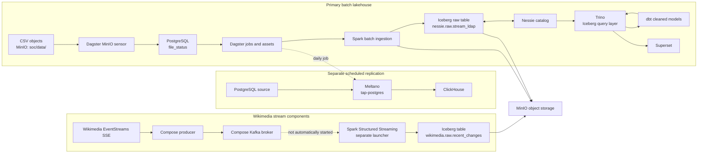

# Modern Data Lineage

**One platform for the entire data lifecycle: ingestion, versioned storage, transformation, governance, serving, observability, and downstream consumption.**

<!-- Core Platform -->
[](#getting-started)
[](#tech-stack)
[](#tech-stack)

<!-- Storage and Table Format -->
[](#storage-table-format-and-data-versioning)
[](#storage-table-format-and-data-versioning)
[](#storage-table-format-and-data-versioning)

<!-- Orchestration and Processing -->
[](#orchestration-and-event-driven-pipelines)
[](#data-flow-and-medallion-layers)
[](#data-flow-and-medallion-layers)
[](#query-analytics-and-bi)

<!-- Sources and Metadata -->
[](#tech-stack)
[](#tech-stack)
[](#tech-stack)

<!-- Query, Analytics and BI -->
[](#query-analytics-and-bi)
[](#query-analytics-and-bi)
[](#query-analytics-and-bi)

<!-- Observability and Alerting -->
[](#observability-and-alerting)
[](#observability-and-alerting)
[](#observability-and-alerting)
[](#observability-and-alerting)

<!-- Security and Delivery -->
[](#security-and-secrets-management)
[](#cicd-and-deployment)

## Overview

Modern Data Lineage is a locally deployable data platform centered on a Dagster-orchestrated batch workflows. It moves files from MinIO through Spark into a Nessie-cataloged Iceberg table, builds cleaned tables with dbt, and makes lakehouse data queryable through Trino. Separate Compose services support a scheduled Meltano PostgreSQL-to-ClickHouse job and a Wikimedia-to-Kafka producer; the Spark consumer for that stream is provided as a standalone launcher, not an automatically running service. The repository favors explicit file registration and observable job state over claiming capabilities that are not implemented.

### Contents

- [Platform at a Glance](#platform-at-a-glance)
- [Key Features](#key-features)
- [Architecture](#architecture)
- [Tech Stack](#tech-stack)
- [Data Flow and Medallion Layers](#data-flow-and-medallion-layers)
- [Orchestration and Event-Driven Pipelines](#orchestration-and-event-driven-pipelines)
- [Storage, Table Format and Data Versioning](#storage-table-format-and-data-versioning)
- [DataOps and Data Quality](#dataops-and-data-quality)
- [Query, Analytics and BI](#query-analytics-and-bi)
- [Observability and Alerting](#observability-and-alerting)
- [Security and Secrets Management](#security-and-secrets-management)
- [Repository Structure](#repository-structure)
- [Getting Started](#getting-started)
- [Configuration](#configuration)
- [Operations](#operations)
- [CI/CD and Deployment](#cicd-and-deployment)
- [Design Decisions](#design-decisions)
- [Extensibility and Downstream Integrations](#extensibility-and-downstream-integrations)
- [Roadmap](#roadmap)
- [Contributing and License](#contributing-and-license)

## Platform at a Glance

| Capability | Repository implementation |
| --- | --- |
| File ingestion | MinIO CSV discovery, PostgreSQL file registry, and Spark batch processing |
| Relational replication | Dagster-defined daily Meltano `tap-postgres` to `target-clickhouse` job |
| Object storage | MinIO S3-compatible service |
| Table format and catalog | Apache Iceberg with a Nessie catalog for the batch lakehouse |
| Processing | Apache Spark batch ingestion; dbt models over Trino |
| Orchestration | Dagster assets, jobs, sensors, and a daily schedule definition |
| Query serving | Trino Iceberg connector; Trino is internal to the Compose network |
| BI | Apache Superset service with the Trino Python driver installed |
| Observability | Dagster run/compute logs and application logging |
| Secrets/configuration | Environment variables loaded from a local, untracked `.env` file |
| Delivery | Local Docker Compose deployment; no repository CI/CD workflow is defined |

## Key Features

- **Tracked file lifecycle:** CSV objects discovered in MinIO are registered in PostgreSQL and move through `new`, `inprogress`, `success`, or `failed` states.
- **Validated batch ingestion:** Spark checks the expected `_serial` and `_raw` columns, casts the selected fields, rejects null or invalid `_serial` values, and writes to Iceberg.
- **Merge-based updates:** Existing raw-table records are merged by `_serial`; successfully processed input is also archived as Parquet in MinIO.
- **SQL transformation:** dbt defines `cleaned.stream_ldap` and `cleaned.ldap_event_enriched` table models.
- **Lakehouse query path:** Trino uses the Iceberg connector and Nessie catalog to read the MinIO-backed lakehouse.
- **Separate replication job:** Dagster defines a daily Meltano `pg-ch` job for a configured PostgreSQL source and ClickHouse target.
- **Interactive Spark environment:** A Jupyter service mounts `spark-apps/` for interactive exploration.
- **Separate streaming components:** Compose runs the Wikimedia SSE producer and Kafka broker. A Spark Structured Streaming consumer and launcher are present, but are not started by Compose or Dagster.

## Architecture

The original repository architecture diagram is preserved here:


The following view distinguishes the operational batch workflow from the separately configured replication and partially wired stream consumer.



### Layer-by-layer walkthrough

| Layer | Implemented path |
| --- | --- |
| Ingestion | Dagster discovers CSV files in MinIO; a PostgreSQL registry tracks them. A separate Dagster schedule invokes Meltano for PostgreSQL-to-ClickHouse replication. |
| Storage | MinIO holds the landing files, Parquet archive, and Iceberg warehouse. Nessie catalogs the main batch table. |
| Processing | Spark validates and merges incoming CSV data. dbt parses the raw JSON payload into cleaned tables. |
| Serving | Trino queries Iceberg through Nessie. ClickHouse is the target of the separate Meltano job. |
| BI | Superset is available as a service. Its container installs the Trino driver; configure the Trino database connection in Superset. |
| Observability | Dagster captures run and compute logs; the Spark launcher, Spark jobs, and producer emit application logs. |
| Consumption | Use Trino and Superset for the batch lakehouse, and ClickHouse for data delivered by the Meltano job. Trino has no host port mapping in Compose. |

## Tech Stack

| Layer | Technology | Repository-specific purpose |
| --- | --- | --- |
| Orchestration | Dagster | Defines assets, jobs, sensors, resources, and the Meltano schedule; metadata is stored in PostgreSQL. |
| Batch processing | Apache Spark 4.0.2 | Reads registered CSV files from MinIO, validates and merges raw Iceberg records, and archives processed data as Parquet. |
| Transformation | dbt with Trino adapter | Builds the `cleaned` tables from the raw Iceberg source. |
| Object storage | MinIO | Provides S3-compatible landing and warehouse storage in the local Compose stack. |
| Table format | Apache Iceberg | Stores the batch raw table and the separately launched streaming output. |
| Catalog | Project Nessie | Catalog for the batch Iceberg table; Spark uses the configured `main` reference. |
| Query | Trino | Uses its Iceberg connector and Nessie catalog to query the batch lakehouse. |
| Orchestration metadata and registry | PostgreSQL | Stores Dagster metadata and the CSV `file_status` registry; also configured as the Meltano state/source database. |
| Replication | Meltano, Singer `tap-postgres`, `target-clickhouse` | Defines the separate `pg-ch` PostgreSQL-to-ClickHouse job with `LOG_BASED` replication configuration. |
| BI | Apache Superset 3.1.1 | Web UI service; its startup script installs the Trino driver. |
| Streaming broker | Apache Kafka 4.3.1 | Compose broker for the Wikimedia producer. |
| Streaming source | Wikimedia EventStreams SSE | Source used by the Compose `kafka-producer` service. |
| Interactive analysis | Jupyter and PySpark | Notebook service with `spark-apps/` mounted at `/opt/notebooks`. |
| Local deployment | Docker Compose | Runs the platform services on the local Compose network. |

## Data Flow and Medallion Layers

The implemented schemas are named `raw` and `cleaned`; the mapping below describes their role without implying a complete three-layer medallion implementation.

| Logical layer | Implemented object | Processing and contents |
| --- | --- | --- |
| Bronze / raw | `nessie.raw.stream_ldap` | Spark reads CSV with a header, requires `_serial` and `_raw`, casts them to integer and string, checks `_serial` for nulls, and creates or merges the Iceberg table using `_serial`. |
| Silver / cleaned | `cleaned.stream_ldap`, `cleaned.ldap_event_enriched` | dbt parses fields from `_raw` and derives event classification and time attributes. Both models are configured as tables and tagged `cleaned`. |
| Gold | Not implemented | There is no separate `gold` schema or Gold model layer in the repository. |

The `structured` dbt directory contains empty model/schema files and does not constitute an implemented layer. The separate `wikimedia.raw.recent_changes` table is written by the standalone streaming application using a Hadoop Iceberg catalog, not the batch Nessie catalog.

## Orchestration and Event-Driven Pipelines

Dagster definitions are assembled in `dagster/repository.py`. The Compose stack runs a webserver and daemon; PostgreSQL is configured for Dagster run and event storage.

### MinIO CSV pipeline

1. `s3_csv_check_sensor` checks MinIO for CSV files under `soc/data/` at a 60-second minimum interval and requests `file_registration_job`.
2. The registration op inserts filenames into `file_status` with status `new`.
3. `postgres_pending_files_ingestion_sensor` checks for new rows at a 50-second minimum interval, marks them `inprogress`, assigns a job ID, and requests `bronze_logs_ingestion_job`.
4. The `logs_ingest_parquet_write` asset launches `spark-apps/logs_ingest_parquet_write.py` on the Spark master.
5. The asset records `success` or `failed` based on the Spark process exit code; a non-zero exit is raised as a Dagster failure.

Both sensors have `default_status=STOPPED`; start them in the Dagster UI to enable discovery and processing. The `mel_pg_ch_job` schedule is defined for `0 2 * * *` (daily at 02:00). The streaming consumer has no Dagster job or schedule.

## Storage, Table Format and Data Versioning

- **Object store:** MinIO serves the `soc` bucket. CSV inputs use the `data/` prefix; the Spark job writes Parquet archives below `data/archived/`.
- **Batch table:** Spark creates or merges `nessie.raw.stream_ldap` in Iceberg, using the Nessie catalog and MinIO-backed warehouse.
- **Catalog reference:** Spark is configured with the Nessie `main` reference. The repository does not define a branch creation, promotion, or rollback procedure; no branch-based release workflow is described here.
- **Query access:** Trino's `trino/catalog/nessie.properties` configures the Iceberg connector against Nessie and MinIO.
- **Separate stream table:** The standalone streaming launcher configures a Hadoop Iceberg catalog and writes `wikimedia.raw.recent_changes` with a MinIO checkpoint path. It is not a Nessie-cataloged table.

## DataOps and Data Quality

The concrete data-quality checks in the batch path are implemented in Spark:

- The CSV header is checked for `_serial` and `_raw`; extra columns are logged and ignored by the selection.
- `_serial` is cast to an integer and the job raises an error if it becomes null.
- Writes use an Iceberg `MERGE INTO` keyed by `_serial`, updating matches and inserting new keys.
- Each processed batch is archived in Parquet, and file status is updated from the Spark process result.
- dbt models are materialized as tables. The repository includes dbt source declarations, but no configured dbt data tests or populated test suite is present.

These are implementation details, not a formal data-contract or schema-evolution framework. SCD models, dbt snapshots, a dedicated backfill mechanism, Dagster retry policies, and automated schema migrations are not implemented in the repository.

## Query, Analytics and BI

- **Trino:** The `nessie` catalog uses the Iceberg connector to read the MinIO-backed batch tables. It listens on container port `8080`, which is not published to the host by `docker-compose.yml`.
- **dbt:** The Trino adapter reads `nessie.raw.stream_ldap` and builds `cleaned.stream_ldap` and `cleaned.ldap_event_enriched`.
- **Superset:** The service is exposed on host port `8088`. Its startup script installs the Trino client/SQLAlchemy packages and initializes Superset. The repository does not seed a Superset database connection; add a Trino connection in the UI using the Compose-network endpoint `trino:8080`.
- **ClickHouse:** Meltano's configured target is ClickHouse. This is a separate PostgreSQL replication path, not the Trino Iceberg serving path.

## Observability and Alerting

Implemented observability is log-based:

- Dagster provides run and compute logs; local compute logs are configured under `/opt/dagster/logs`.
- Spark application and launcher output is forwarded into Dagster logs when launched by the batch asset.
- The Wikimedia producer uses Python logging; Spark logs are available when the standalone consumer is run.
- Docker Compose provides container logs for its services.


## Security and Secrets Management

Compose reads environment settings from a local `.env` file, which is ignored by Git. Start with `.env.example`, supply environment-specific values locally, and do not commit credentials. The example file lists variable names without values.

## Repository Structure

```text
modern-data-lineage/
├── .env.example                         # Blank environment-variable inventory
├── docker-compose.yml                   # Local services and published ports
├── docs/
│   └── BatchDataPlatformArchitecture.png # Existing architecture diagram
├── dagster/
│   ├── repository.py                    # Dagster Definitions entry point
│   ├── assets/                          # Spark and dbt assets
│   ├── jobs/                            # File registration, ingestion, Meltano jobs
│   ├── ops/                             # File registry and Meltano operations
│   ├── resources/                       # MinIO, PostgreSQL, and dbt resources
│   ├── schedules/                       # Daily PostgreSQL-to-ClickHouse schedule
│   └── sensors/                         # MinIO file and PostgreSQL registry sensors
├── spark-apps/
│   ├── logs_ingest_parquet_write.py     # Main Spark batch ingestion
│   ├── wikimedia_streaming.py           # Standalone streaming consumer
│   ├── scripts/                         # Batch and streaming launchers
│   └── utils/                           # CSV column checks and Spark logging
├── dbt/modern_data_lineage/
│   ├── dbt_project.yml                  # dbt project
│   ├── dbt/profiles.yml                 # Trino adapter target
│   └── models/
│       ├── cleaned/                     # Implemented dbt table models
│       └── structured/                  # Empty model placeholders
├── meltano/
│   ├── meltano.yml                      # PostgreSQL tap and ClickHouse target
│   └── plugins/                         # Meltano plugin lock files
├── kafka-sse-producer/                  # Wikimedia SSE-to-Kafka producer
├── notebook/                            # Spark/Jupyter image definition
├── docker/                              # PostgreSQL initialization and Superset startup
└── trino/catalog/nessie.properties      # Trino Iceberg/Nessie catalog
```

## Getting Started

### Prerequisites

- Git
- Docker Engine with the Docker Compose plugin
- A local `.env` populated with the required settings for the services and pipelines you intend to run

The repository's `.env.example` contains blank values, not ready-to-use credentials. Review [Configuration](#configuration) before starting the stack. No sample `data/logs.csv` is tracked.

### Clone and configure

```bash
git clone https://github.com/safi-io/modern-data-lineage.git
cd modern-data-lineage
cp .env.example .env
```

Edit `.env` locally and provide values appropriate for this Compose deployment. Do not paste credentials into this README or commit `.env`.

### Start and verify the services

```bash
docker compose up -d --build
docker compose ps
```

| Service | Host URL or port | Notes |
| --- | --- | --- |
| Dagster webserver | `http://localhost:3000` | Dagster UI |
| MinIO API | `http://localhost:8999` | Host mapping to container port `9000` |
| MinIO console | `http://localhost:9001` | Credentials come from local environment configuration |
| Superset | `http://localhost:8088` | Admin account is initialized from local environment configuration |
| Spark master UI | `http://localhost:8081` | Spark master web UI |
| Spark master | `localhost:7077` | Spark cluster endpoint |
| Jupyter | `http://localhost:8888` | Interactive Spark notebook service |
| PostgreSQL | `localhost:5432` | Internal metadata, registry, and state database |
| Nessie | `http://localhost:19120` | Nessie service |
| ClickHouse HTTP | `http://localhost:8123` | HTTP interface |
| ClickHouse native | `localhost:10000` | Host mapping to container port `9000` |
| Kafka | `localhost:29092` | Published broker listener; internal clients use `kafka:9092` |
| Trino | Not published to host | Internal Compose endpoint `http://trino:8080` |
| Spark worker UI | Dynamic host port | Compose publishes container port `8081` without a fixed host port |

### Run the first batch pipeline

1. In MinIO, create the `soc` bucket if needed and upload a CSV to `soc/data/`. It must have `_serial` and `_raw` header columns; `_raw` should contain JSON text. The local sample uploader expects `data/logs.csv`, which is not included in this repository.
2. Open the Dagster UI and start `s3_csv_check_sensor` and `postgres_pending_files_ingestion_sensor`; both are stopped by default.
3. Confirm file registration and the Spark run in Dagster. The processed file status and Spark logs are visible in the run details.
4. Once the raw table exists, materialize the cleaned dbt assets in Dagster. They run `dbt build` for the `cleaned` tag.
5. To query from Superset, add a Trino database connection using `trino:8080` from within the Compose network. Trino itself has no published host port.

## Configuration

### Environment variables

`.env.example` lists variable names only. This table groups those names by purpose; it intentionally contains no values.

<details>
<summary>Show environment variable names and purposes</summary>

| Variables | Purpose |
| --- | --- |
| `SPARK_MASTER_URL`, `SPARK_URL` | `SPARK_URL` is used by the batch Spark launcher. `SPARK_MASTER_URL` is listed in `.env.example` but is not read by tracked code. |
| `DAGSTER_HOME` | Dagster runtime home. |
| `DAGSTER_PG_HOST`, `DAGSTER_PG_PORT`, `DAGSTER_PG_USER`, `DAGSTER_PG_PASSWORD`, `DAGSTER_INTERNAL_PG_DB`, `DAGSTER_CUSTOM_PG_DB` | Dagster metadata and application file-registry PostgreSQL connection. `DAGSTER_PG_PORT` is used by the application resource; Dagster storage itself is configured for port `5432` in `dagster/dagster.yaml`. |
| `POSTGRES_USER`, `POSTGRES_PASSWORD`, `POSTGRES_DB` | Base PostgreSQL container initialization settings. |
| `MINIO_ENDPOINT`, `MINIO_ENDPOINT_RESOURCE`, `MINIO_BUCKET_URL`, `MINIO_ACCESS_KEY`, `MINIO_SECRET_KEY`, `MINIO_ROOT_USER`, `MINIO_ROOT_PASSWORD` | MinIO endpoint, warehouse, application credentials, and root credentials. |
| `NESSIE_ENDPOINT`, `NESSIE_BRANCH`, `NESSIE_VERSION_STORE_TYPE`, `NESSIE_VERSION_STORE_PERSIST_ROCKS_DB_PATH` | Nessie endpoint, Spark reference, and version-store settings. |
| `SUPERSET_SECRET_KEY`, `SUPERSET_ADMIN_USERNAME`, `SUPERSET_ADMIN_FIRSTNAME`, `SUPERSET_ADMIN_LASTNAME`, `SUPERSET_ADMIN_EMAIL`, `SUPERSET_ADMIN_PASSWORD` | Superset application and initial administrator settings. |
| `MELTANO_DATABASE_URI` | Meltano state database URI. |
| `TAP_POSTGRES_HOST`, `TAP_POSTGRES_PORT`, `TAP_POSTGRES_USER`, `TAP_POSTGRES_PASSWORD`, `TAP_POSTGRES_DBNAME` | Meltano PostgreSQL extractor connection. |
| `TARGET_CLICKHOUSE_HOST`, `TARGET_CLICKHOUSE_PORT`, `TARGET_CLICKHOUSE_USERNAME`, `TARGET_CLICKHOUSE_PASSWORD`, `TARGET_CLICKHOUSE_DATABASE`, `TARGET_CLICKHOUSE_DEFAULT_TARGET_SCHEMA`, `TARGET_CLICKHOUSE_ENGINE_TYPE` | Meltano ClickHouse loader configuration. |
| `CLICKHOUSE_DB`, `CLICKHOUSE_USER`, `CLICKHOUSE_PASSWORD`, `CLICKHOUSE_DEFAULT_ACCESS_MANAGEMENT` | ClickHouse container settings. |
| `KAFKA_NODE_ID`, `KAFKA_PROCESS_ROLES`, `KAFKA_LISTENERS`, `KAFKA_ADVERTISED_LISTENERS`, `KAFKA_LISTENER_SECURITY_PROTOCOL_MAP`, `KAFKA_INTER_BROKER_LISTENER_NAME`, `KAFKA_CONTROLLER_LISTENER_NAMES`, `KAFKA_OFFSETS_TOPIC_REPLICATION_FACTOR`, `KAFKA_TRANSACTION_STATE_LOG_REPLICATION_FACTOR`, `KAFKA_TRANSACTION_STATE_LOG_MIN_ISR`, `KAFKA_GROUP_INITIAL_REBALANCE_DELAY_MS`, `KAFKA_NUM_PARTITIONS`, `KAFKA_CONTROLLER_QUORUM_VOTERS` | Kafka broker and KRaft configuration. |
| `KAFKA_PRODUCER_WIKIMEDIA_URL`, `KAFKA_PRODUCER_BOOTSTRAP_SERVERS`, `KAFKA_PRODUCER_TOPIC`, `KAFKA_PRODUCER_USER_AGENT_HEADERS` | Wikimedia SSE producer source, Kafka destination, and request headers. |

</details>

### Key configuration files

| File | Purpose |
| --- | --- |
| `docker-compose.yml` | Service definitions, volumes, dependency ordering, and host port mappings. |
| `dagster/dagster.yaml` | PostgreSQL-backed Dagster storage and local compute-log settings. |
| `dagster/workspace.yaml` | Dagster workspace code location. |
| `spark-apps/scripts/run_spark.sh` | Batch Spark submit options and required runtime environment. |
| `spark-apps/scripts/run_wikimedia_streaming_job.sh` | Standalone streaming Spark and Iceberg configuration. |
| `dbt/modern_data_lineage/dbt_project.yml` | dbt project and model-path configuration. |
| `dbt/modern_data_lineage/dbt/profiles.yml` | dbt Trino connection target. |
| `meltano/meltano.yml` | Meltano PostgreSQL extractor, ClickHouse loader, and `pg-ch` job. |
| `trino/catalog/nessie.properties` | Trino Iceberg connector, Nessie catalog, and MinIO endpoint settings. |
| `docker/superset-init.sh` | Superset initialization and Trino driver installation. |

## Operations

### Backfills and reprocessing

There is no dedicated backfill command or backfill job. File registration uses `ON CONFLICT (file_name) DO NOTHING`; uploading the same object name does not create another registry row. For an intentional reprocessing run, upload the corrected/replay data under a new object name in `soc/data/`, then let the normal sensors register and process it. Spark merges table records by `_serial` and writes a timestamped Parquet archive.

### Adding a source

The implemented lakehouse ingestion contract is MinIO CSV with `_serial` and `_raw` columns. The separate relational replication route is configured in `meltano/meltano.yml` for PostgreSQL to ClickHouse. Adding another source requires implementing its connector and registering/orchestrating its ingestion path; the repository does not provide generic REST, FTP, MongoDB, Snowflake, or cloud-storage connectors.

### Adding a dbt model

Add a model under `dbt/modern_data_lineage/models/`, define its source or ref dependencies and model configuration, and apply the `cleaned` tag if it should be included by the Dagster dbt asset selection. The configured adapter is Trino. Build models through the Dagster dbt asset or an environment with the repository's dbt profile configured.

### Schema evolution

The Spark CSV validation currently requires `_serial` and `_raw`, logs extra input columns, and selects those two columns for the raw table. To evolve the input, coordinate changes to that validation/projection and the Iceberg write behavior with any affected dbt source/model definitions. No automatic schema migration or compatibility policy is configured.

### Troubleshooting

<details>
<summary>Show common checks</summary>

| Symptom | Check |
| --- | --- |
| Dagster sensors do not discover files | Start both sensors in the Dagster UI; confirm the `soc` bucket and `data/` prefix, MinIO connectivity, and `.env` values. |
| A Spark run cannot start | Check that `spark-master` is running and that the required Spark, Nessie, MinIO, and PostgreSQL settings are populated in `.env`. |
| A file is rejected | Confirm the CSV header contains `_serial` and `_raw`, and that `_serial` values cast to integers. Review the Dagster run logs. |
| dbt assets cannot build | Confirm the raw Iceberg table exists, Trino is running, and the dbt Trino profile can reach `trino:8080` from the Dagster container. |
| Superset has no lakehouse connection | Create the Trino database connection in Superset; the repository installs the driver but does not seed the connection. |
| Wikimedia events do not appear in Iceberg | Compose starts the producer and broker only. Launch the standalone Spark consumer separately and ensure its topic matches the producer's configured topic. |

</details>

Useful Compose inspection commands:

```bash
docker compose ps
docker compose logs dagster-webserver
docker compose logs spark-master
```

## CI/CD and Deployment

The repository defines a local Docker Compose deployment. No GitHub Actions workflow, CI pipeline, Terraform configuration, cloud deployment manifest, or environment-promotion workflow is present. The Compose file defines the local services and volumes; adapting the platform to a server or cloud environment requires deployment configuration that is not included here.

Meltano declares `dev`, `staging`, and `prod` environment names in its project configuration, but this does not provide platform-wide deployment or promotion automation.

## Design Decisions

| Choice | Observed implementation and trade-off |
| --- | --- |
| Batch-first primary workflow | The core lakehouse path discovers files, registers them, processes a group of registered files in Spark, and records completion state. The repository does not document volume-based sizing or a latency/throughput benchmark. |
| Iceberg with Nessie for the batch table | Spark writes the raw Iceberg table through Nessie and Trino reads that catalog. The repository configures the `main` reference; it does not implement branch promotion or a branching workflow. |
| Dagster for orchestration | Dagster definitions group assets, file sensors, jobs, and the separate daily Meltano schedule, with PostgreSQL-backed run/event storage and run logs. |
| Spark plus dbt | Spark handles file ingestion, type conversion, validation, merging, and archiving; dbt handles SQL parsing and enrichment through Trino. |
| Trino alongside ClickHouse | Trino is the query layer over Iceberg; ClickHouse is the target of a distinct Meltano PostgreSQL replication job. The repository does not configure ClickHouse as the lakehouse query engine. |
| Separate stream components | Kafka and the Wikimedia producer run as Compose services, while the Spark consumer has a separate launcher. The stream table uses a Hadoop catalog rather than the batch Nessie catalog. |

## Extensibility and Downstream Integrations

The current integration points are concrete and narrow:

- Add compatible CSV files to the MinIO landing path for the batch lakehouse flow.
- Extend the dbt project with additional Trino-backed models.
- Extend the Meltano project with supported extractor/loader configuration for a separate replication path.
- Use Trino or configure Superset for access to the batch Iceberg catalog.
- Run the existing Wikimedia Spark consumer separately when its Kafka source and runtime are configured.

Reverse ETL, ML pipelines, API serving, and enterprise application integrations are not implemented in this repository.

## Roadmap

- **In progress:** Complete the Wikimedia Spark Structured Streaming runtime integration. The consumer, launcher, Iceberg sink, and checkpoint path exist, but Compose and Dagster do not start the consumer.

## Contributing

Contributions are welcome. Whether you are fixing a bug, improving documentation, adding a new source connector, or extending the modeling layers, your input helps make the platform better.

To contribute:

1. Fork the repository and create a feature branch.
2. Describe the affected ingestion or modeling path in your pull request.
3. Include validation appropriate to the change, such as sample runs, dbt tests, or pipeline output checks.
4. Open a pull request and describe what changed and why.

For larger changes or new ideas, open an issue first so we can discuss the approach.

## Connect

If you want to discuss the platform, collaborate, or just connect, you can find me here:

[](https://linkedin.com/in/safi-io)
[](https://github.com/safi-io)
[](https://hashnode.com/@safi-io)
